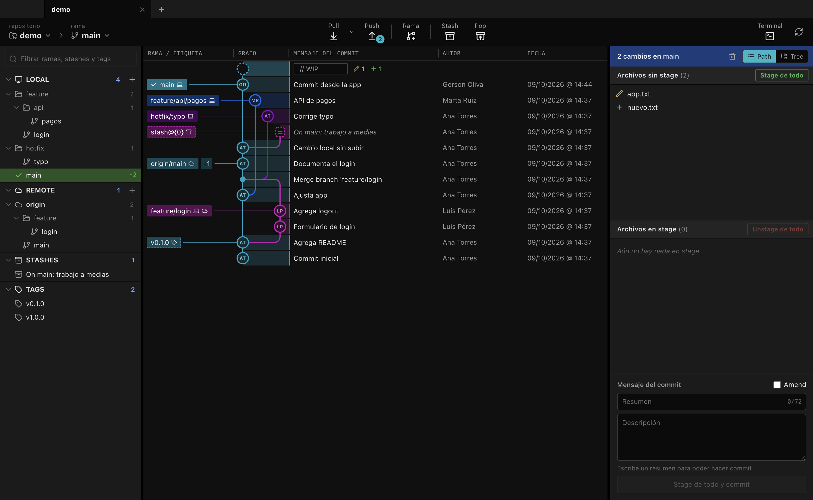
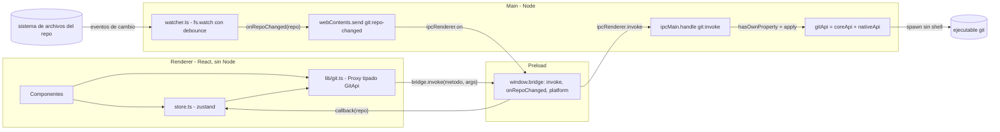
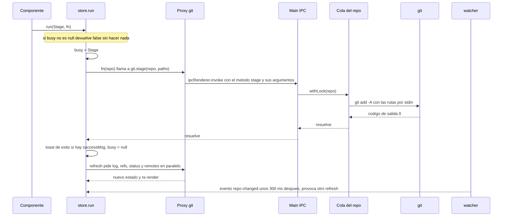

# GitKroken — Documentación técnica

GitKroken es un cliente Git de escritorio (Electron + React + TypeScript) cuyo aspecto y flujo de trabajo siguen los de GitKraken: pestañas de repositorio, barra de herramientas, barra lateral de referencias, grafo de commits en el centro y, a la derecha, el detalle del commit o el área de preparación (*staging*). No usa ninguna librería de Git: todas las operaciones se hacen lanzando el ejecutable `git` del sistema.

Este documento describe lo que hay en el código en la versión `0.1.0` (commit `be394ac`, 9 de octubre de 2026). Todo lo que se afirma sobre el comportamiento sale de la lectura del código fuente y de la ejecución de las pruebas; la sección 10 (historia) recoge además hechos de la sesión de construcción que no están en el código.



## Índice

1. [Qué es y qué puede hacer](#1-qué-es-y-qué-puede-hacer)
2. [Requisitos y ejecución](#2-requisitos-y-ejecución)
3. [Arquitectura](#3-arquitectura)
4. [El backend de Git](#4-el-backend-de-git)
5. [El renderer](#5-el-renderer)
6. [El grafo de commits](#6-el-grafo-de-commits)
7. [El visor de diffs](#7-el-visor-de-diffs)
8. [Sistema de diseño](#8-sistema-de-diseño)
9. [Pruebas](#9-pruebas)
10. [Cómo se construyó](#10-cómo-se-construyó)
11. [Limitaciones conocidas y próximos pasos](#11-limitaciones-conocidas-y-próximos-pasos)
12. [Mapa de archivos](#12-mapa-de-archivos)

---

## 1. Qué es y qué puede hacer

### 1.1 Funcionalidades por área

**Repositorios y pestañas**

- Abrir un repositorio eligiendo una carpeta (diálogo nativo). Cualquier carpeta dentro de un repositorio sirve: se resuelve a la raíz con `git rev-parse --show-toplevel`.
- Clonar un repositorio (URL + carpeta de destino) e iniciar un repositorio nuevo (`git init`).
- Varias pestañas de repositorio; se recuerdan entre sesiones junto con la pestaña activa y una lista de hasta 12 repositorios recientes.
- Cerrar pestaña (botón, clic central o menú contextual), «Cerrar las demás» y «Mostrar en la carpeta».

**Barra de herramientas**

- Selector de repositorio (pestañas abiertas y recientes, con filtro) y selector de rama local (con filtro; al elegir una rama se hace checkout).
- Pull (merge), con un desplegable para «Fetch de todos los remotos», «Pull (merge)» y «Pull (rebase)». Push de la rama actual. Los botones muestran como insignia los commits por detrás / por delante de la rama actual.
- Crear rama en `HEAD` y cambiar a ella. Stash de los cambios locales y Pop del stash más reciente.
- Abrir una terminal del sistema en el repositorio y botón de actualizar.
- Banda de operación en curso (merge, rebase, cherry-pick, revert) con «Continuar» y «Abortar».

**Barra lateral**

- Secciones LOCAL, REMOTE, STASHES y TAGS, plegables, con contador y filtro de texto común.
- Las ramas con `/` en el nombre se muestran como árbol de carpetas. Las ramas locales muestran `↑n ↓n` respecto a su upstream; la rama actual se marca con un check.
- Un clic selecciona en el grafo el commit al que apunta la referencia; doble clic en una rama hace checkout.
- Menús contextuales: checkout, merge en la rama actual, rebase de la rama actual, push, renombrar, copiar nombre, eliminar (local y remota), fetch, copiar URL, quitar remoto, aplicar / pop / eliminar stash, checkout / eliminar tag.
- Botones `+` para crear rama y para añadir un remoto.

**Grafo de commits**

- Historial de todas las ramas, tags y stashes en orden `--date-order`, dibujado con carriles de colores, nodos con las iniciales del autor, nodos pequeños para merges y nodos cuadrados discontinuos para stashes.
- Fila «// WIP» en lo alto cuando hay cambios sin confirmar, unida a `HEAD` por una línea discontinua, con contadores de archivos modificados, añadidos, eliminados y en conflicto.
- Columnas Rama / Etiqueta, Grafo, Mensaje, Autor, Fecha y SHA, redimensionables; las tres últimas se ocultan cuando falta espacio.
- Lista virtualizada con carga por páginas de 2000 commits al acercarse al final.
- Selección con ratón y teclado (flechas, RePág / AvPág, Inicio, Fin).
- Menú contextual de commit: checkout, crear rama, crear etiqueta (ligera o anotada), cherry-pick, revertir, reset soft / mixed / hard y copiar SHA. Menú de stash y de la fila WIP (guardar en stash, descartar todo).
- Píldoras de referencia: doble clic para checkout, menú contextual propio y arrastrar una rama sobre otra para fusionar o hacer rebase.

**Panel derecho**

- Con un commit seleccionado: asunto, cuerpo, referencias, autor con avatar de iniciales, fecha absoluta y relativa, padres (clic para saltar a ellos) y lista de archivos modificados en vista plana (*Path*) o de árbol (*Tree*).
- Con la fila WIP seleccionada (o sin selección pero con cambios): listas de archivos en conflicto, sin stage y en stage; Stage / Unstage por archivo, por carpeta o de todo; descartar un archivo o todos los cambios; formulario de commit con resumen, descripción, contador de 72 caracteres y casilla Amend.

**Visor de diffs**

- Al hacer clic en un archivo, el centro de la ventana cambia del grafo al diff de ese archivo.
- Tres vistas: *Hunk*, *Inline* y *Split*; resaltado de cambios a nivel de palabra; lista virtualizada.
- Para archivos del árbol de trabajo: Stage File / Unstage File y, en la vista Hunk, Stage Hunk, Unstage Hunk y Discard Hunk.
- Avisos específicos para archivos binarios, vacíos, renombrados sin cambios o con solo cambio de modo.

**Actualización automática**

- El proceso principal vigila el repositorio con `fs.watch`; los cambios hechos fuera de la aplicación (editor, terminal) refrescan la vista. También se refresca al recuperar el foco la ventana.

### 1.2 Lo que NO está implementado

De forma explícita, nada de lo siguiente existe en el código:

- Integraciones con servicios de alojamiento o gestión (GitHub, GitLab, Bitbucket, Azure DevOps, Jira, etc.). No hay inicio de sesión, ni API de terceros, ni gestión de credenciales.
- Pull requests, issues, equipos, *cloud patches* y agentes.
- Editor de conflictos de merge. Un archivo en conflicto se muestra como diff combinado de solo lectura; hay que resolverlo con un editor externo y después marcarlo como resuelto (Stage).
- Rebase interactivo. Solo existe `git rebase <rama>` y continuar / abortar.
- Deshacer / rehacer.
- Empaquetado e instalador (véase la sección 2).

Otras ausencias que conviene conocer se listan en la sección 11.

---

## 2. Requisitos y ejecución

### 2.1 Requisitos

| Requisito | Detalle |
| --- | --- |
| Node.js | La máquina de desarrollo usa Node 20.11.1. `electron-vite`, `vite` y `vitest` declaran `^18.0.0 \|\| >=20.0.0`. |
| Git | Debe estar en el `PATH`. Se ha usado Git 2.39.0. El código no comprueba una versión mínima, pero depende de opciones relativamente recientes: `status --porcelain=v2`, `--pathspec-from-file`, `--diff-merges=first-parent` y, en las pruebas, `GIT_CONFIG_GLOBAL`. |
| Sistema operativo | El desarrollo y las pruebas se hicieron en macOS. El código tiene ramas para Windows y Linux (barra de título, terminal, separadores de ruta), pero no consta que se hayan ejecutado. |

Versiones instaladas de las dependencias principales (`node_modules`): Electron 39.8.10, electron-vite 2.3.0, Vite 5.4.21, React 18.3.1, Zustand 4.5.7, lucide-react 0.441.0, TypeScript 5.9.3, Vitest 2.1.9, `@vitejs/plugin-react` 4.7.0.

### 2.2 Comandos

| Comando | Qué hace |
| --- | --- |
| `npm install` | Instala dependencias. El paquete `electron` descarga su binario en el *postinstall*. |
| `npm run dev` | `electron-vite dev`: compila main y preload, levanta el servidor de Vite para el renderer y abre Electron cargando `ELECTRON_RENDERER_URL`. |
| `npm run build` | `electron-vite build`: genera `out/main/index.js`, `out/preload/index.js` y `out/renderer/` (HTML + un JS y un CSS en `assets/`). |
| `npm start` | `electron-vite preview`: compila para producción (salvo `--skipBuild`) y arranca Electron sobre `out/`. |
| `npm test` | `vitest run`: ejecuta una vez todas las pruebas unitarias y de integración. |
| `npm run typecheck` | `tsc --noEmit -p tsconfig.json`: comprueba tipos de todo `src/` (incluidas las pruebas). |

`package.json` declara `"main": "./out/main/index.js"`, de modo que Electron siempre arranca desde la salida compilada.

### 2.3 No hay empaquetado

No existe ningún paso de empaquetado ni instalador: no hay dependencia de `electron-builder` ni de Electron Forge, ni script `dist` o `package`, ni configuración de firma o notarización. La aplicación solo se puede ejecutar desde el repositorio con `npm run dev` o `npm start`. (`.gitignore` ya ignora una carpeta `dist`, pero nada la genera.)

### 2.4 Configuración de compilación

- `electron.vite.config.ts` define tres compilaciones. *main* y *preload* usan `externalizeDepsPlugin()` (las dependencias de `node_modules` no se incluyen en el bundle) y el alias `@shared` → `src/shared`. *renderer* usa `@vitejs/plugin-react` y los alias `@shared` y `@` → `src/renderer/src`.
- `tsconfig.json`: `strict`, `moduleResolution: "Bundler"`, `jsx: "react-jsx"`, `noEmit`, y los mismos alias en `paths`.
- No hay `vitest.config.*`. Las pruebas funcionan sin resolver el alias `@shared` porque todos los módulos que cargan lo importan solo como tipo (`import type`), que desaparece al transpilar. Los dos únicos archivos que importan valores de `@shared/types` (`src/main/index.ts` y `src/preload/index.ts`) no se cargan en ninguna prueba. Si un módulo probado necesitara un valor de `@shared`, habría que añadir el alias a la configuración de Vitest.

---

## 3. Arquitectura

### 3.1 Los tres procesos

| Proceso | Entrada | Responsabilidad |
| --- | --- | --- |
| Main (Node) | `src/main/index.ts` | Crea la ventana, registra el único manejador IPC y ejecuta Git (`src/main/git/`). |
| Preload | `src/preload/index.ts` | Expone `window.bridge` al renderer mediante `contextBridge`. Es el único punto de contacto entre ambos mundos. |
| Renderer (Chromium) | `src/renderer/src/main.tsx` | Interfaz React. No tiene acceso a Node ni a Electron: solo a `window.bridge`. |

El contrato entre los tres está en un único archivo, `src/shared/types.ts`: los tipos de datos (`Commit`, `Ref`, `Status`, `FileChange`, `CommitDetails`, `Remote`, `DiffRequest`, `ResetMode`), la interfaz `GitApi` con los 45 métodos disponibles, la interfaz `Bridge` y los nombres de los dos canales IPC.

### 3.2 Un único canal IPC genérico

En lugar de un canal por operación hay un solo canal de petición-respuesta y un solo canal de eventos:

| Constante | Valor | Sentido | Uso |
| --- | --- | --- | --- |
| `IPC_INVOKE` | `'git:invoke'` | renderer → main (`invoke` / `handle`) | Llamar a cualquier método de `GitApi`. |
| `IPC_REPO_CHANGED` | `'git:repo-changed'` | main → renderer (`send`) | Avisar de que un repositorio vigilado ha cambiado. |

El recorrido de una llamada es:

1. **Renderer.** `src/renderer/src/lib/git.ts` exporta `git`, un `Proxy` tipado como `GitApi`. Acceder a `git.status` devuelve una función que llama a `window.bridge.invoke('status', ...args)`. El proxy no conoce los métodos: cualquier nombre se reenvía, y es TypeScript quien garantiza que solo se usen los del contrato.
2. **Preload.** `bridge.invoke(method, ...args)` hace `ipcRenderer.invoke('git:invoke', method, args)`.
3. **Main.** El manejador busca `method` en el objeto `gitApi` y solo lo ejecuta si es una **propiedad propia** y una función (`Object.prototype.hasOwnProperty.call(gitApi, method)`); así nombres como `constructor` o `toString` se rechazan con `Unknown git method`. Después hace `fn.apply(gitApi, args)` y devuelve la promesa.
4. **Errores.** Si la promesa se rechaza, Electron la serializa como `Error invoking remote method 'git:invoke': Error: <mensaje>`. El renderer elimina ese prefijo con la expresión regular de `errText` antes de mostrar el mensaje. Por eso `GitError` conserva deliberadamente `name === 'Error'`.

`gitApi` (`src/main/git/index.ts`) es un objeto plano que une `coreApi` (todo lo que solo necesita el ejecutable `git`, sin importar Electron) y `nativeApi` (diálogo de carpetas, mostrar en Finder, abrir terminal).



### 3.3 Ventana y ajustes de seguridad

`createWindow()` en `src/main/index.ts`:

| Ajuste | Valor | Comentario |
| --- | --- | --- |
| Tamaño | 1440×900, mínimo 960×600 | |
| `backgroundColor` | `#101010` | Igual que `--bg-1`, para que no haya destello al abrir. |
| `titleBarStyle` | `hiddenInset` en macOS, `default` en el resto | En macOS la barra de pestañas hace de zona de arrastre (`.drag-region`) y reserva 78 px a la izquierda para los botones de ventana (`.tb-mac`). |
| `contextIsolation` | `true` | El preload y la página no comparten contexto de JavaScript. |
| `nodeIntegration` | `false` | El renderer no puede usar `require`. |
| `sandbox` | `false` | El preload se ejecuta sin sandbox. Solo usa `contextBridge`, `ipcRenderer` y `process.platform`. |
| `setWindowOpenHandler` | Siempre `deny` | Las URL `http(s)` se abren en el navegador del sistema con `shell.openExternal`; nunca se crea otra ventana. |

Además, `src/renderer/index.html` declara una *Content Security Policy*:

```
default-src 'self'; style-src 'self' 'unsafe-inline'; img-src 'self' data: https://www.gravatar.com
```

Dos observaciones sobre la CSP: permite imágenes de `gravatar.com`, pero el código no carga ningún avatar remoto (los nodos y avatares usan iniciales); y no permite scripts en línea, lo que puede afectar al modo de desarrollo (véase 11.2).

No hay manejador de `will-navigate`, ni validación del remitente en el manejador IPC, ni menú de aplicación propio (se usa el de Electron por defecto), ni bloqueo de instancia única. El ciclo de vida es el habitual: en macOS la aplicación sigue viva sin ventanas y `activate` crea una nueva; en el resto de plataformas se cierra al cerrar la última ventana.

### 3.4 Cómo llegan los cambios del repositorio al store

1. Cuando una pestaña se activa, `store.setActive(path)` llama a `git.watch(path)`. En main, `watcher.ts` abre un `fs.watch` recursivo sobre el repositorio.
2. Cada evento de archivo pasa por el filtro `isNoise` y, si no es ruido, programa una emisión con *debounce* de 300 ms (como máximo 2 s desde el primer evento de la ráfaga).
3. Al vencer el temporizador se llama a los *listeners* registrados con `onRepoChanged`. El único registrado en producción está en `src/main/index.ts` y hace `webContents.send('git:repo-changed', repo)` a todas las ventanas.
4. En el preload, `bridge.onRepoChanged(cb)` suscribe `cb` a ese canal y devuelve la función para cancelar la suscripción.
5. `initStore()` (llamado una vez desde `App`) se suscribe: si el repositorio del evento es el activo **y no hay ninguna operación en curso** (`busy === null`), llama a `refresh()`. También llama a `refresh()` cada vez que la ventana recibe el foco.

El filtro `busy` evita refrescos a mitad de una operación: `run()` ya hace su propio `refresh()` al terminar. Como el evento del watcher llega unos 300 ms después de la escritura, es habitual que una mutación provoque dos refrescos seguidos (el de `run` y el del watcher). Es redundante pero inocuo: el grafo conserva el layout si la topología no cambió y el visor de diffs conserva su estado si el texto es idéntico.

`watch` solo se deshace al cerrar la pestaña (`closeTab` → `git.unwatch`). Cambiar de pestaña deja el repositorio anterior vigilado; sus eventos se ignoran en el renderer porque no es el activo.

### 3.5 Flujo de una mutación

Todas las escrituras de la interfaz pasan por `store.run(label, fn, successMsg?)`. El diagrama muestra «Stage» de un archivo:



Si `fn` falla, `run` muestra un *toast* de error con el texto `<label>: <mensaje de git>`, pone `busy` a `null`, refresca igualmente y devuelve `false`.

---

## 4. El backend de Git

Todo el backend vive en `src/main/git/`:

| Archivo | Contenido | ¿Importa Electron? |
| --- | --- | --- |
| `exec.ts` | Ejecución de `git`, entorno, errores y validación de argumentos. | No |
| `parse.ts` | Analizadores puros de la salida de Git. | No |
| `core.ts` | Todos los métodos de `GitApi` que solo necesitan Git y el sistema de archivos, más la cola por repositorio. | No |
| `watcher.ts` | Vigilancia de archivos y `onRepoChanged`. | No |
| `native.ts` | `pickDirectory`, `reveal`, `openInTerminal`. | Sí (único archivo) |
| `index.ts` | Une `coreApi` y `nativeApi` en `gitApi`. | Indirectamente |

Que solo `native.ts` importe Electron es lo que permite probar el resto en Node puro contra repositorios reales.

### 4.1 Cómo se lanza Git (`exec.ts`)

`runGit(cwd, args, opts)` es el único sitio donde se crea un proceso de Git:

- **Sin shell.** Se usa `spawn('git', [...BASE_CONFIG, ...args], { cwd, ... })` con los argumentos como array. No hay interpolación de cadenas ni posibilidad de inyección por la línea de órdenes.
- **Configuración forzada** (`BASE_CONFIG`), para que la salida sea analizable sea cual sea el `gitconfig` del usuario: `color.ui=false`, `core.quotepath=false`, `diff.noprefix=false`, `diff.mnemonicPrefix=false`, `log.showSignature=false`.
- **Variables de entorno** añadidas a las del proceso:

  | Variable | Valor | Motivo |
  | --- | --- | --- |
  | `GIT_TERMINAL_PROMPT` | `0` | Nunca esperar credenciales por terminal. |
  | `GIT_EDITOR`, `GIT_SEQUENCE_EDITOR` | `true` | Ninguna orden puede abrir un editor: el «editor» es el comando `true`, que acepta el mensaje propuesto. |
  | `GIT_MERGE_AUTOEDIT` | `no` | Los merges no piden editar el mensaje. |
  | `GIT_PAGER` | `cat` | Sin paginador. |
  | `LC_ALL`, `LANG` | `C` | Salida estable y sin traducir (por eso los mensajes de error de Git aparecen en inglés). |
  | `GIT_OPTIONAL_LOCKS` | `0` | Las lecturas (`status`) no reescriben el índice; de lo contrario dispararían el propio watcher en bucle. |
  | `GIT_LITERAL_PATHSPECS` | `1` solo si `opts.literal` | Las rutas que vienen de la interfaz son nombres de archivo, nunca globs ni *pathspecs* mágicos. No es global porque rompe órdenes como `git stash -u`. |
  | `PATH` | En macOS se añaden `/usr/local/bin` y `/opt/homebrew/bin` si faltan | Las aplicaciones gráficas arrancan con un `PATH` mínimo; así se encuentran `git-lfs`, gestores de credenciales o `gpg`. |

- **Sin terminal de control.** En plataformas distintas de Windows el proceso se crea con `detached: true` (sesión propia). Si la aplicación se lanzó desde una shell, `ssh` o `gpg` no pueden preguntar en esa terminal y quedarse colgados de forma invisible.
- **stdin siempre se cierra.** Se escribe `opts.input` (o cadena vacía) y se cierra, así que Git nunca espera entrada.
- **Límite de salida.** Se acumulan `stdout` y `stderr` hasta 400 MiB; si se supera, se mata el proceso y se rechaza con «Git produced too much output».
- **Códigos de salida.** Por defecto solo `0` es éxito; `opts.okCodes` permite aceptar otros (por ejemplo `[0, 1]` para `show-ref --verify --quiet` o `diff --no-index`).
- **Validación previa.** Se rechaza un `cwd` vacío y cualquier argumento que no sea cadena o que contenga un byte NUL.

No hay tiempo de espera ni forma de cancelar un proceso en marcha.

**Errores.** Si el código de salida no es aceptable se rechaza con un `GitError` (subclase de `Error` con `code`, `stdout`, `stderr` y `args`). Su mensaje lo produce `cleanGitMessage`:

1. Divide `stderr` y `stdout` en líneas, descarta las vacías y las que empiezan por `hint:`, y quita los prefijos `fatal: `, `error: ` y `warning: `.
2. Si hay líneas de `stderr`, el mensaje son las líneas `CONFLICT …` de `stdout` (Git informa de los conflictos por la salida estándar) seguidas de las de `stderr`. Si no hay `stderr`, el mensaje es `stdout`.
3. Elimina duplicados conservando el orden y recorta a 30 líneas.
4. Si no queda nada, usa un texto de reserva (`git <orden> failed (exit code N)` o `Git was terminated (<señal>)`).

Cuando falla el propio `spawn` (`ENOENT` / `ENOTDIR`) se distingue entre «Folder not found: …» (la carpeta `cwd` no existe; Node lo comunica como si faltara el ejecutable) y «Git executable not found…».

Dos envoltorios simplifican el uso: `git()` devuelve solo `stdout` y `tryGit()` devuelve `null` en lugar de rechazar.

**Validación de argumentos.**

- `assertRef(valor, qué)`: exige una cadena no vacía, que **no empiece por `-`** (Git la interpretaría como opción) y sin caracteres de control. Se aplica a nombres de rama, tag, remoto, hashes y a la URL de `addRemote`.
- `assertPaths(rutas)`: exige un array de cadenas no vacías y sin NUL. Las rutas siempre viajan después de `--` o por stdin.
- En `core.ts`: `assertInsideRepo` (la ruta de un archivo sin seguimiento no puede salir del repositorio), `assertStashIndex` (entero ≥ 0, se convierte en `stash@{N}`), y `clone` rechaza una URL que empiece por `-`.

**Rutas por stdin.** `gitWithPaths` ejecuta órdenes que reciben rutas con `--pathspec-from-file=- --pathspec-file-nul` y las rutas separadas por NUL en stdin, de modo que una selección enorme no puede superar el límite de longitud de argumentos del sistema operativo.

### 4.2 Cola de mutaciones por repositorio

Dos procesos que escriben el índice a la vez hacen que Git falle con `index.lock: File exists`. Para evitarlo, `core.ts` mantiene un `Map<repo, Promise>`: `withLock(repo, fn)` encadena `fn` detrás de la promesa anterior del mismo repositorio (tanto si acabó bien como mal) y limpia la entrada cuando la cola queda vacía. El envoltorio `mut(fn)` aplica esto usando el primer argumento (la ruta del repositorio) como clave.

- **Encoladas** (`mut`): `stage`, `unstage`, `stageAll`, `unstageAll`, `discard`, `discardAll`, `applyPatch`, `commit`, `checkout`, `createBranch`, `deleteBranch`, `renameBranch`, `merge`, `rebase`, `cherryPick`, `revert`, `reset`, `abort`, `continueOp`, `createTag`, `deleteTag`, `pull`, `addRemote`, `removeRemote`, `stashSave`, `stashPop`, `stashApply`, `stashDrop`.
- **No encoladas**: todas las lecturas, `fetch`, `push` y `deleteRemoteBranch` (no tocan el índice ni el árbol de trabajo, y una red lenta no debe bloquear el *staging*), además de `resolveRepo`, `init`, `clone`, `watch` y `unwatch`.

La cola vive en el proceso principal y es independiente del indicador `busy` del renderer, que además impide lanzar dos operaciones a la vez desde la interfaz.

### 4.3 Lectura del historial: `log`

Formato pedido a Git (`LOG_FORMAT`): `%H %P %an %ae %at %s %b` separados por `%x00`, con `git log -z`, de modo que cada commit son siete campos terminados en NUL. Como un mensaje de commit no puede contener NUL, el análisis es inequívoco. `parseLog` recorre los tokens de siete en siete y se detiene si el primero no es un hash de 40 a 64 hexadecimales. La fecha es la de autor en segundos Unix; el cuerpo se guarda sin espacios finales.

La orden completa es:

```
git log --date-order -z --format=<LOG_FORMAT> [--skip=N] [--max-count=N]
        --exclude=refs/notes/* --exclude=refs/replace/* --exclude=refs/original/*
        --exclude=refs/bisect/* --exclude=refs/prefetch/*
        --all <hash de cada stash> --
```

Es decir, todas las referencias salvo las de contabilidad interna, más los stashes (porque `--all` solo alcanza `stash@{0}`; los anteriores viven en el reflog).

**Stashes.** Un stash es un commit de merge: `parents[0]` es el commit sobre el que se hizo, `parents[1]` guarda el estado del índice y `parents[2]` (opcional) los archivos sin seguimiento. Para que cada stash sea un único nodo:

1. Se listan los stashes con `git stash list -z --format=%H%x00%P%x00%gs`. El índice `N` de `stash@{N}` es la posición en la lista, no `%gd` (que `log.date` puede convertir en una fecha).
2. Los padres segundo y tercero de cada stash se consideran «auxiliares» y se eliminan del resultado.
3. Cada commit que es un stash se marca con `isStash: true` y se le dejan solo sus padres `[0]`.

**Paginación.** Sin stashes se delega en `--skip` y `--max-count`. Con stashes, el `--skip` de Git quedaría descuadrado por los auxiliares filtrados, así que se pide desde el principio (`--max-count = skip + limit + nº de auxiliares`), se filtra y se recorta en JavaScript. Consecuencia: en un repositorio con stashes, cada página adicional vuelve a leer el historial desde arriba.

### 4.4 Referencias: `refs`

Se ejecuta `git for-each-ref` sobre `refs/heads`, `refs/remotes` y `refs/tags` con siete campos separados por NUL: nombre completo, hash, hash «pelado» (`%(*objectname)`), upstream corto, `upstream:track,nobracket`, marca `HEAD` y `symref`. `parseRefs` produce:

- **Ramas locales** (`type: 'head'`): `isCurrent` si la marca es `*`; si hay upstream se guardan `upstream`, `ahead` y `behind` (extraídos de `ahead N, behind M`), salvo que el seguimiento sea `gone`.
- **Ramas remotas** (`type: 'remote'`): se omiten las simbólicas y las que acaban en `/HEAD` (`origin/HEAD`).
- **Tags** (`type: 'tag'`): para los anotados se usa el hash del commit al que apuntan, no el del objeto tag.

A la lista se añaden los stashes como `Ref` de tipo `'stash'`, con nombre `stash@{N}` y su mensaje. El orden final es: locales, remotas, tags, stashes.

### 4.5 Estado: `status`

```
git status --porcelain=v2 -z --branch --untracked-files=all --find-renames --no-ahead-behind
```

`parseStatus` recorre las entradas separadas por NUL:

| Entrada | Significado | Resultado |
| --- | --- | --- |
| `# branch.oid` | Hash de `HEAD` o `(initial)` | `head` (`null` si no hay commits) |
| `# branch.head` | Nombre de rama o `(detached)` | `branch` (`null` si `HEAD` está separado) |
| `1 XY …` | Cambio normal | `X ≠ .` añade a `staged`; `Y ≠ .` añade a `unstaged` |
| `2 XY … ruta NUL rutaOriginal` | Renombrado o copia | Igual, con `oldPath` en el lado que sea `R` o `C` |
| `u …` | Sin fusionar | `conflicted` |
| `? ruta` | Sin seguimiento | `unstaged` con estado `untracked` |

Un mismo archivo puede estar a la vez en `staged` y `unstaged`. Las letras se traducen así: `A` añadido, `D` eliminado, `R` renombrado, `C` copiado, `U` en conflicto y cualquier otra (`M`, `T`) modificado.

El campo `inProgress` no sale de `git status`, sino de mirar qué archivos existen en el directorio de Git (`detectInProgress`), en este orden: `rebase-merge` → rebase; `rebase-apply` sin `rebase-apply/applying` → rebase; `MERGE_HEAD` → merge; `CHERRY_PICK_HEAD` → cherry-pick; `REVERT_HEAD` → revert. El rebase se comprueba primero porque un rebase detenido por conflicto también deja `CHERRY_PICK_HEAD` o `REVERT_HEAD`.

### 4.6 Detalle de un commit y diffs

**`commitDetails(repo, hash)`** lee el commit con `git log -1` (mismo formato que el historial) y sus archivos con:

```
git diff-tree -r --root --no-commit-id --name-status -z --find-renames --diff-merges=first-parent <rev> --
```

`--root` hace que el commit raíz se compare con el árbol vacío y `--diff-merges=first-parent` que un merge se compare con su primer padre. Si el commit es un stash, se marca como tal, se le dejan solo sus padres `[0]` y, si tenía un tercer padre, se añaden los archivos de ese commit (los que estaban sin seguimiento al guardar el stash).

**`diff(repo, req)`** devuelve texto de diff unificado (cadena vacía si no hay cambios). Siempre usa `--no-color --no-ext-diff --no-textconv --find-renames` para que la salida sea un parche aplicable. Si `oldPath` es distinto de `path` se pasan ambas rutas (para que Git detecte el renombrado).

| `DiffRequest` | Orden |
| --- | --- |
| `commit` | `git diff-tree -p --root --no-commit-id … --diff-merges=first-parent <rev> -- <rutas>`. Si sale vacío y el commit tiene tres padres cuyo tercero es un commit raíz (stash con archivos sin seguimiento), se repite contra ese tercer padre. |
| `untracked: true` | `git diff … --no-index -- /dev/null <ruta>` (el código de salida 1 es normal). |
| `staged: true` | `git diff --cached … -- <rutas>` (índice frente a `HEAD`). |
| ninguno | `git diff … -- <rutas>` (árbol de trabajo frente a índice). Si sale vacío y `git ls-files --others --exclude-standard` confirma que el archivo está sin seguimiento, se trata como `untracked`. |

**`remotes`** analiza `git remote -v`, quedándose con una URL por remoto y prefiriendo la de *fetch*.

### 4.7 Staging y commit: semántica

- **`stage(paths)`** — `git add -A` con las rutas por stdin. `-A` hace que también se preparen las eliminaciones.
- **`unstage(paths)`** — `git reset -q` limitado a rutas (funciona también antes del primer commit). **Renombrados:** antes consulta los cambios preparados con detección de renombrados; si una ruta pedida es el nombre nuevo de un renombrado, añade también el nombre antiguo. Sin esto, la eliminación del nombre antiguo se quedaría preparada.
- **`stageAll`** — `git add -A`.
- **`unstageAll`** — no usa un `git reset` a secas (borraría `MERGE_HEAD`) ni `reset -- .` (borraría el estado de conflicto de los archivos sin fusionar). Pide exactamente las rutas preparadas y no conflictivas con `git diff --cached --name-only -z --no-renames --diff-filter=u` (la `u` minúscula excluye las no fusionadas) y hace `git reset -q` sobre ellas desde la raíz del repositorio.
- **`discard(paths)`** — descarta los cambios del **árbol de trabajo** de las rutas indicadas (archivos o carpetas):
  1. Obtiene el estado sin detección de renombrados, limitado a las rutas si son 50 o menos (si son más, filtra en JavaScript).
  2. Archivos con seguimiento cuyo árbol de trabajo difiere del índice: `git checkout` con las rutas por stdin, es decir, **se restauran desde el índice**. Lo que ya estaba en stage se conserva; un archivo nuevo ya preparado vuelve a su contenido preparado.
  3. Archivos en conflicto: `git checkout HEAD -- <ruta>` (se toma «nuestro» lado); si `HEAD` no tiene ese archivo, `git rm -f`.
  4. Archivos sin seguimiento: `git clean -f -q -- <rutas>` en lotes de 200. **Se borran del disco.**
- **`discardAll`** — con commits: `git reset --hard HEAD --` y después `git clean -f -d -q`. Sin commits: `git rm -r -f -q --cached --ignore-unmatch -- .` y el mismo `clean`. Elimina cambios preparados, sin preparar y archivos sin seguimiento; no usa `-x`, así que los archivos ignorados se conservan.
- **`applyPatch(patch, { cached, reverse })`** — `git apply --whitespace=nowarn --recount [--cached] [--reverse] -` con el parche por stdin (se le añade un salto de línea final si falta). Es la base de Stage / Unstage / Discard Hunk (sección 7.6).
- **`commit(message, { amend })`** — el mensaje va por stdin con `git commit -F -`. Sin `amend`, un mensaje vacío se rechaza. Con `amend`: mensaje vacío → `git commit --amend --no-edit` (conserva el mensaje); mensaje con texto → `git commit --amend -F -`.

### 4.8 Ramas e historial: semántica

- **`checkout(ref)`**:
  1. Si `ref` no es una rama local pero existe `refs/remotes/<ref>`, se trata como rama remota. El nombre del remoto es el más largo de los remotos conocidos que sea prefijo de `ref` (los remotos pueden contener `/`); el resto es el nombre local.
  2. Si esa rama local ya existe, se hace `git checkout <local> --` (no se mueve ni se actualiza). Si no existe, `git checkout -b <local> --track refs/remotes/<ref>`.
  3. En cualquier otro caso (rama local, tag o hash): `git checkout <ref> --`. Con un tag o un hash, `HEAD` queda separado.
- **`createBranch(name, startPoint?, checkout?)`** — `git checkout --no-track -b` o `git branch --no-track`. `--no-track` evita que una rama creada desde `origin/main` herede `origin/main` como destino de push.
- **`deleteBranch(name, force?)`** — `git branch -d` o `-D`. **`renameBranch`** — `git branch -m`.
- **`merge(ref)`** — `git merge --no-edit <ref>`. **`rebase(onto)`** — `git rebase <onto>`.
- **`cherryPick(hash)`** y **`revert(hash)`** — si el commit es un merge se añade `-m 1` (se toma como referencia su primer padre). `revert` usa `--no-edit`.
- **`reset(hash, mode)`** — `git reset --soft|--mixed|--hard <hash> --`; cualquier otro modo se rechaza.
- **`abort()`** — según `detectInProgress`: `merge --abort`, `rebase --abort`, `cherry-pick --abort` o `revert --abort`. Sin operación en curso lanza un error.
- **`continueOp()`** — merge: `git commit --no-edit`; rebase: `git rebase --continue`; cherry-pick y revert: `--continue`. Ninguna puede abrir un editor porque `GIT_EDITOR=true`.
- **`createTag(name, hash, message?)`** — con mensaje crea un tag anotado (`-a --message=`); sin mensaje, uno ligero. **`deleteTag`** — `git tag -d` (solo local).

### 4.9 Remotos: semántica

- **`fetch`** — `git fetch --all --prune`.
- **`pull({ rebase })`** — `git pull --no-edit` más: `--rebase` si `rebase === true`; `--no-rebase` si `rebase === false`; si no se indica, respeta `pull.rebase` del usuario y, si no está configurado, añade `--no-rebase` (sin una elección explícita Git se niega a reconciliar ramas divergentes).
- **`push({ branch, force })`**:
  1. La rama es `branch` o la actual; con `HEAD` separado se rechaza con un mensaje claro. La rama debe existir en local.
  2. Se consulta su upstream (`%(upstream:remotename)` y `%(upstream:remoteref)`).
  3. Con upstream remoto: `git push [--force-with-lease] -- <remoto> refs/heads/<rama>:<ref remota>`.
  4. Sin upstream: el remoto es `origin` si existe o, si no, el primero; sin remotos se rechaza. Se añade `-u` (fija el upstream) y se empuja a `refs/heads/<rama>`. Excepción: si la rama sigue a otra rama local (remoto `.`), no se añade `-u` para no alterar esa configuración.
  5. `force` usa siempre `--force-with-lease`, nunca `--force`.
- **`deleteRemoteBranch(remote, branch)`** — `git push -- <remoto> :refs/heads/<rama>`.
- **`addRemote`** / **`removeRemote`** — `git remote add` / `git remote remove`.

### 4.10 Stashes

- **`stashSave(message?)`** — `git stash push --include-untracked [--message=…]`. Git sale con 0 aunque no haya nada que guardar; si la salida contiene «No local changes to save» se lanza un error.
- **`stashPop(N)`**, **`stashApply(N)`**, **`stashDrop(N)`** — `git stash pop|apply|drop stash@{N}`.

### 4.11 Integración con el sistema (`native.ts`)

- **`pickDirectory(title?)`** — `dialog.showOpenDialog` con `openDirectory` y `createDirectory`, sobre la ventana con foco. El título se pasa también como `message` porque macOS no muestra `title` en los paneles de apertura. Devuelve `null` si se cancela.
- **`reveal(path)`** — `shell.showItemInFolder`.
- **`openInTerminal(repo)`** — comprueba que la carpeta existe y prueba candidatos hasta que uno arranca: en macOS `open -a Terminal <repo>`; en Windows `wt.exe -d <repo>` y luego `cmd.exe`; en Linux `$TERMINAL`, `x-terminal-emulator`, `gnome-terminal`, `konsole`, `xfce4-terminal`, `kitty`, `alacritty` y `xterm`. El proceso se lanza desacoplado (`detached`, `unref`).

### 4.12 El watcher

`watch(repo)` es idempotente y nunca rechaza (vigilar es «lo mejor posible»):

- Abre `fs.watch(repo, { recursive: true, persistent: false })`. Si la plataforma no admite vigilancia recursiva, vigila el nivel superior y la carpeta `.git` de forma no recursiva.
- Consulta `git rev-parse --absolute-git-dir --git-common-dir`; si alguno de esos directorios queda **fuera** del árbol de trabajo (worktrees enlazados, submódulos), lo vigila también.

**Filtro `isNoise`.** Se ignoran:

| Ámbito | Se ignora |
| --- | --- |
| Dentro de `.git` | La propia entrada `.git`; cualquier `*.lock`; `objects/`, `hooks/`, `info/`, `lfs/`, `fsmonitor--daemon*`; `gc.pid`, `gc.log`, `COMMIT_EDITMSG`, `FETCH_HEAD`; temporales (`tmp_*`, `*.tmp`, `*~`). |
| Árbol de trabajo | Cualquier ruta con `node_modules` o con un `.git` anidado; `.DS_Store`, `Thumbs.db`; archivos de intercambio de editores (`.*.sw?`, `4913`, `*~`). |

Lo que sí pasa: ediciones del árbol de trabajo y cambios en `index`, `HEAD`, `refs/`, `packed-refs`, `logs/`, `MERGE_HEAD`, `rebase-merge/`, etc. Los objetos sueltos se ignoran porque cualquier cambio relevante también mueve una referencia, `HEAD` o el índice.

**Debounce.** Cada evento válido reprograma un temporizador de 300 ms (`DEBOUNCE_MS`); bajo actividad constante (una compilación escribiendo archivos) se garantiza una emisión al menos cada 2 s desde el primer evento (`MAX_WAIT_MS`). Un *listener* que lance una excepción no afecta a los demás.

`unwatch(repo)` cierra los vigilantes y cancela el temporizador; `unwatchAll()` se usa en las pruebas.

### 4.13 Referencia de `GitApi`

Agrupada como en `src/shared/types.ts`. Todos los métodos devuelven una promesa. «Cola» indica si la llamada se serializa por repositorio.

**Repositorios**

| Método | Qué hace | Cola |
| --- | --- | --- |
| `pickDirectory(title?)` | Selector nativo de carpeta; `null` si se cancela. | No |
| `resolveRepo(path)` | Raíz del repositorio que contiene `path` (`rev-parse --show-toplevel`), o `null`. Si `path` es un archivo se usa su carpeta. | No |
| `init(path)` | Crea la carpeta si hace falta, `git init`, y devuelve la raíz. | No |
| `clone(url, parentDir)` | `git clone -- <url> <parentDir>/<nombre>`; el nombre se deduce de la URL (`repoNameFromUrl`, quita `.git` / `.bundle`). Devuelve la ruta del nuevo repositorio. | No |
| `watch(repo)` / `unwatch(repo)` | Empieza / deja de vigilar el repositorio. | No |

**Lectura**

| Método | Qué hace | Cola |
| --- | --- | --- |
| `log(repo, { limit?, skip? })` | Commits de todas las ramas y stashes, más recientes primero (4.3). | No |
| `refs(repo)` | Ramas locales, remotas, tags y stashes (4.4). | No |
| `status(repo)` | Rama, `HEAD`, listas `staged` / `unstaged` / `conflicted` e `inProgress` (4.5). | No |
| `commitDetails(repo, hash)` | Commit y archivos que modifica (4.6). | No |
| `diff(repo, req)` | Diff unificado de un archivo (4.6). | No |
| `remotes(repo)` | Nombre y URL de cada remoto. | No |

**Staging y commit**

| Método | Orden principal | Cola |
| --- | --- | --- |
| `stage(repo, paths)` | `git add -A` (rutas por stdin) | Sí |
| `unstage(repo, paths)` | `git reset -q` (rutas por stdin, incluye el nombre antiguo de los renombrados) | Sí |
| `stageAll(repo)` | `git add -A` | Sí |
| `unstageAll(repo)` | `git reset -q` sobre las rutas preparadas no conflictivas | Sí |
| `discard(repo, paths)` | `git checkout` desde el índice + `git clean -f` para lo no seguido | Sí |
| `discardAll(repo)` | `git reset --hard HEAD` + `git clean -f -d` | Sí |
| `applyPatch(repo, patch, { cached?, reverse? })` | `git apply --whitespace=nowarn --recount … -` | Sí |
| `commit(repo, message, { amend? })` | `git commit [--amend] -F -` | Sí |

**Ramas e historial**

| Método | Orden principal | Cola |
| --- | --- | --- |
| `checkout(repo, ref)` | `git checkout <ref> --`, o crea / reutiliza la rama local de una remota | Sí |
| `createBranch(repo, name, startPoint?, checkout?)` | `git branch --no-track` o `git checkout --no-track -b` | Sí |
| `deleteBranch(repo, name, force?)` | `git branch -d` / `-D` | Sí |
| `renameBranch(repo, oldName, newName)` | `git branch -m` | Sí |
| `merge(repo, ref)` | `git merge --no-edit` | Sí |
| `rebase(repo, onto)` | `git rebase` | Sí |
| `cherryPick(repo, hash)` | `git cherry-pick [-m 1]` | Sí |
| `revert(repo, hash)` | `git revert --no-edit [-m 1]` | Sí |
| `reset(repo, hash, mode)` | `git reset --soft\|--mixed\|--hard` | Sí |
| `abort(repo)` | `--abort` de la operación en curso | Sí |
| `continueOp(repo)` | `--continue` (o `commit --no-edit` para un merge) | Sí |
| `createTag(repo, name, hash, message?)` | `git tag [-a --message=]` | Sí |
| `deleteTag(repo, name)` | `git tag -d` | Sí |

**Remotos**

| Método | Orden principal | Cola |
| --- | --- | --- |
| `fetch(repo)` | `git fetch --all --prune` | No |
| `pull(repo, { rebase? })` | `git pull --no-edit [--rebase\|--no-rebase]` | Sí |
| `push(repo, { branch?, force? })` | `git push [--force-with-lease] [-u] -- <remoto> <refspec>` | No |
| `deleteRemoteBranch(repo, remote, branch)` | `git push -- <remoto> :refs/heads/<rama>` | No |
| `addRemote(repo, name, url)` | `git remote add` | Sí |
| `removeRemote(repo, name)` | `git remote remove` | Sí |

**Stashes**

| Método | Orden principal | Cola |
| --- | --- | --- |
| `stashSave(repo, message?)` | `git stash push --include-untracked` | Sí |
| `stashPop(repo, index)` | `git stash pop stash@{N}` | Sí |
| `stashApply(repo, index)` | `git stash apply stash@{N}` | Sí |
| `stashDrop(repo, index)` | `git stash drop stash@{N}` | Sí |

**Varios**

| Método | Qué hace | Cola |
| --- | --- | --- |
| `reveal(path)` | Muestra la ruta en Finder / el gestor de archivos. | No |
| `openInTerminal(repo)` | Abre una terminal del sistema en el repositorio. | No |

---

## 5. El renderer

### 5.1 Arranque y estructura

`main.tsx` monta `<App />` (sin `StrictMode`) e importa `theme.css`. `App.tsx` compone la ventana:

```
TabBar
└─ si hay repositorio activo:
     Toolbar (+ banda de operación en curso)
     app-body:  Sidebar | resizer | centro (Graph o DiffView) | resizer | RightPanel
   si no:
     Welcome
Overlays (menú contextual, diálogo, toasts)
```

El centro muestra `DiffView` cuando `selectedFile` no es `null` y `Graph` en caso contrario. Los dos paneles laterales se redimensionan arrastrando los separadores (`useResizable`): el izquierdo entre 160 y 480 px (250 por defecto) y el derecho entre 260 y 640 px (360 por defecto); el ancho se guarda en `localStorage`.

### 5.2 El store (`store.ts`)

Un único store de Zustand, `useStore`, contiene el estado del repositorio **activo** (no hay estado por pestaña: al cambiar de pestaña se vacía y se vuelve a cargar).

| Campo | Tipo | Significado |
| --- | --- | --- |
| `tabs` | `RepoTab[]` | Pestañas abiertas (`{ path, name }`). Persistido. |
| `recent` | `RepoTab[]` | Hasta 12 repositorios recientes, el último primero. Persistido. |
| `activeRepo` | `string \| null` | Ruta del repositorio activo; `null` muestra la bienvenida. |
| `commits` | `Commit[]` | Commits cargados. |
| `hasMore` | `boolean` | Si puede haber más páginas. |
| `refs`, `remotes`, `status` | | Última lectura del backend. |
| `loading` | `boolean` | Hay un `refresh` o `loadMore` en curso. |
| `busy` | `string \| null` | Etiqueta de la mutación en curso (por ejemplo `"Push"`). |
| `selected` | `string \| null` | Hash seleccionado, la constante `WIP` (`'WIP'`) o `null`. |
| `selectedFile` | `SelectedFile \| null` | Archivo cuyo diff se muestra: `{ path, oldPath?, commit?, staged?, untracked? }`. |

Acciones:

- **`openRepo(path)`** — resuelve la raíz con `git.resolveRepo`; si no es un repositorio muestra un toast de error. Añade la pestaña si no existía, actualiza los recientes, persiste ambos y llama a `setActive`.
- **`closeTab(path)`** — quita la pestaña, la persiste, llama a `git.unwatch` y, si era la activa, activa la vecina (o `null`).
- **`setActive(path)`** — guarda la pestaña activa, **vacía** `commits`, `refs`, `remotes`, `status`, `hasMore`, `selected` y `selectedFile`, y si hay ruta llama a `git.watch` y a `refresh`. Como reinicia el estado, quienes la llaman evitan invocarla para la pestaña ya activa.
- **`refresh()`** — pide en paralelo `log`, `refs`, `status` y `remotes`. Detalles de secuenciación:
  - Un contador de módulo `refreshSeq` numera cada refresco. Al volver la respuesta, si ya hay un refresco posterior o el repositorio activo cambió, **se descarta**. Solo el refresco más reciente apaga `loading` o muestra el error.
  - El límite pedido es `max(2000, commits.length)`: si ya se cargaron más páginas, se recargan todas para que el grafo no se acorte.
  - `hasMore = commits.length >= limit`.
  - La selección se conserva si sigue existiendo (un hash presente en la lista, `WIP` o `null`); si el commit seleccionado ya no está, se limpian `selected` y `selectedFile`.
- **`loadMore()`** — si hay más y no se está cargando, pide `log` con `limit: 2000` y `skip: commits.length`, y añade el resultado. `hasMore` pasa a `false` cuando la página llega incompleta. `Graph` elimina duplicados por si una página se solapa con un cambio concurrente.
- **`select(hash)`** — cambia la selección y **cierra el diff** (`selectedFile = null`).
- **`selectFile(file)`** — abre o cierra el visor de diffs.
- **`run(label, fn, successMsg?)`** — envoltorio obligatorio de toda escritura (diagrama en 3.5). Si no hay repositorio activo o `busy` no es `null`, devuelve `false` sin hacer nada y sin avisar. En otro caso: `busy = label`, ejecuta `fn(repo)`, muestra el toast de éxito o de error, `busy = null`, espera a `refresh()` y devuelve si fue bien.

**`initStore()`** restaura la última pestaña activa (o la primera), se suscribe a `bridge.onRepoChanged` y al evento `focus` de la ventana, y devuelve la función de limpieza.

### 5.3 Overlays (`components/ui/overlays.tsx`)

Menús contextuales, diálogos y toasts son **imperativos**: cualquier módulo los invoca con una función, sin montar componentes. Tienen su propio store (`useOverlays`) y `<Overlays />` se monta una sola vez en `App`.

| Función | Uso |
| --- | --- |
| `showContextMenu(evento, items)` | Abre el menú en la posición del ratón. `MenuItem` es `{ label, onClick, disabled?, danger? }` o `{ separator: true }`. Se ajusta para no salirse de la ventana y se cierra con clic fuera, pérdida de foco o Escape. |
| `formDialog({ title, message?, fields, confirmLabel?, danger? })` | Diálogo con varios campos de texto. Resuelve con los valores o `null` si se cancela (Escape, clic en el fondo o «Cancelar»). |
| `promptDialog({ title, label, … })` | Un solo campo. Resuelve con el valor recortado o `null` si se cancela o queda vacío. |
| `confirmDialog({ title, message, confirmLabel?, danger? })` | Confirmación sin campos. Resuelve `true` / `false`. |
| `toast(texto, tipo?)` | Aviso en la esquina inferior derecha. Los de error duran 8 s; los demás, 3,5 s. |

Solo puede haber un diálogo a la vez (abrir otro sustituye al anterior).

### 5.4 Paneles y sus archivos

**Pestañas y bienvenida — `components/tabs/`**

- `TabBar.tsx`: pestañas, botón `+` (activa `null`, es decir, la pantalla de bienvenida), cierre con clic central y menú contextual. Toda la barra es zona de arrastre de la ventana; las pestañas son `no-drag`.
- `Welcome.tsx`: tres acciones (Abrir, Clonar, Iniciar) y la lista de recientes con la etiqueta «abierto» para los que ya tienen pestaña. El formulario de clonado recuerda la última carpeta de destino y muestra dónde se clonará. Durante un clonado o un `init` se bloquean los controles y se muestra un indicador.
- `tabs.css`.

**Barra de herramientas — `components/toolbar/`**

- `Toolbar.tsx`: selectores, botones y `OperationBanner`. Reglas de habilitación: Pull y Push se desactivan si hay una operación en curso, si no hay remotos o si `HEAD` está separado; Stash, si no hay cambios; Pop, si no hay stashes; el selector de rama y «Rama», mientras `busy`.
- `Selector.tsx`: desplegable tipo «miga de pan» con leyenda, valor, filtro, grupos, teclado (flechas, Enter, Escape) y acción fija al pie.
- `actions.ts`: utilidades compartidas con la barra lateral y la bienvenida: `run`, `errText`, `shortSha`, `menuBelow` (abre el menú compartido bajo un botón), `copyText`, `checkoutRef`, `createBranchAtHead` (sustituye los espacios del nombre por `-`) y `openRepoFromDisk`.
- `toolbar.css`.

**Barra lateral — `components/sidebar/`**

- `Sidebar.tsx`: filtro, secciones y filas. Mientras se filtra, todo se muestra desplegado. El elemento pulsado queda resaltado mientras su commit siga siendo el seleccionado. Stashes y tags se pintan en páginas de 300 con un botón «Mostrar más».
- `menus.ts`: menús contextuales y sus diálogos. `runOp` solo anuncia el éxito de un merge o rebase si, tras refrescar, no queda una operación en curso (pueden detenerse por conflictos sin fallar). `deleteLocalBranch` intenta `-d` y, si Git responde «not fully merged», ofrece forzar con `-D`.
- `tree.ts`: `buildTree` (carpetas a partir de nombres con `/`, carpetas antes que hojas, orden natural), `groupRemotes` (agrupa ramas remotas por remoto, prefiriendo el nombre de remoto más largo; conserva remotos sin ramas), `splitRemoteRef`, `stashIndex` y `useCollapsed` (estado plegado persistido).
- `sidebar.css`.

**Grafo — `components/graph/`** (sección 6).

**Panel derecho — `components/details/`**

- `RightPanel.tsx` decide qué mostrar: commit seleccionado → `CommitPanel`; sin `status` todavía → «Cargando…»; fila WIP seleccionada, cambios pendientes u operación en curso → `WipPanel`; en otro caso, «Árbol de trabajo limpio».
- `WipPanel.tsx`: cabecera con el número de cambios y la rama, botón de descartar todo, conmutador Path / Tree, franja de operación en curso, secciones de archivos y `CommitForm`. Descartar un archivo de la sección *en stage* hace primero `unstage` y luego `discard` de ambos nombres (si es un renombrado), dentro de un mismo `run`.
- `CommitForm.tsx`: la acción del botón depende del estado:

  | Situación | Acción | Texto del botón |
  | --- | --- | --- |
  | Hay conflictos | Ninguna | «Resuelve los conflictos primero» |
  | Amend marcado | `commit(..., { amend: true })` | «Amend con cambios en N archivos» o «Amend del mensaje del último commit» |
  | Hay archivos en stage | `commit` | «Commit de cambios en N archivos» |
  | Nada en stage pero sí sin stage | `stageAll` y `commit` | «Stage de todo y commit» |
  | Nada que confirmar | Ninguna | «Haz stage de cambios para el commit» |

  Hace falta un resumen no vacío. Enter en el resumen pasa a la descripción; Cmd/Ctrl+Enter envía. Amend solo está disponible si el commit de `HEAD` está cargado y no hay operación en curso; al marcarlo se carga el mensaje del último commit y se guarda lo que se había escrito, que se recupera al desmarcar. Tras un commit correcto se borra el borrador y, si el árbol queda limpio, se selecciona el nuevo `HEAD`.
- `commitDraft.ts`: borradores del formulario por repositorio en un store aparte (`useDrafts`), para que un mensaje a medias sobreviva al cambiar de selección o de pestaña. Solo en memoria: no sobrevive a un reinicio.
- `commitMessage.ts`: `buildCommitMessage` (resumen + línea en blanco + descripción), `messageToFields`, `initials`, `hueOf` (tono estable por autor para el avatar), `relativeTime` (`Intl.RelativeTimeFormat` en español) y `SUMMARY_SOFT_LIMIT = 72`.
- `CommitPanel.tsx`: cabecera con el SHA corto (clic para copiar el completo), metadatos y lista de archivos. Los detalles se guardan en una caché de sesión de hasta 200 commits (los commits son inmutables). Una bandera de cancelación evita que una respuesta antigua pise a una más nueva al cambiar rápido de selección.
- `FileList.tsx`: lista compartida con vista plana o de árbol, botones al pasar el ratón (por archivo y por carpeta) y paginación (400 filas iniciales, «Mostrar más» añade 2000).
- `fileTree.ts`: árbol de carpetas para la vista Tree; fusiona cadenas de carpetas con un único hijo (`src/renderer`).
- `common.tsx` / `common.css`: `StatusIcon`, `Segmented` (grupo de botones excluyentes), `splitPath`, `copyText`, `readPref` / `writePref`, `plural`.
- `RightPanel.css`.

**Visor de diffs — `components/diff/`** (sección 7).

### 5.5 Menús contextuales disponibles

| Dónde | Acciones |
| --- | --- |
| Pestaña | Cerrar pestaña · Cerrar las demás · Mostrar en la carpeta |
| Fila de commit (grafo) | Checkout del commit · Crear rama aquí · Crear etiqueta aquí · Cherry-pick (desactivado en `HEAD`) · Revertir · Reset soft / mixed / hard (hard pide confirmación) · Copiar SHA |
| Fila o píldora de stash | Aplicar · Aplicar y eliminar (pop) · Eliminar (con confirmación) |
| Fila WIP | Guardar cambios en un stash (con mensaje opcional) · Descartar todos los cambios |
| Píldora de rama local | Checkout · Fusionar en la actual · Rebase de la actual sobre esta · Push · Renombrar · Eliminar · Eliminar rama remota (si está fusionada en la píldora) · Copiar nombre |
| Píldora de rama remota | Checkout · Fusionar · Rebase · Eliminar rama remota · Copiar nombre |
| Píldora de tag | Checkout · Eliminar · Copiar nombre |
| Soltar una píldora sobre otra | Fusionar origen en destino · Rebase de origen sobre destino |
| Rama local (barra lateral) | Checkout · Fusionar en la actual · Rebase de la actual sobre esta · Push · Renombrar · Copiar nombre · Eliminar |
| Rama remota (barra lateral) | Checkout · Fusionar en la actual · Copiar nombre · Eliminar |
| Remoto (barra lateral) | Fetch · Copiar URL · Quitar remoto |
| Stash (barra lateral) | Aplicar · Pop · Eliminar |
| Tag (barra lateral) | Checkout · Copiar nombre · Eliminar |
| Archivo del área de staging | Ver cambios · Stage / Unstage / Marcar como resuelto · Descartar cambios o Eliminar archivo · Mostrar en Finder · Copiar ruta · Copiar ruta absoluta |
| Archivo de un commit | Ver cambios · Copiar ruta · Mostrar en Finder |
| Desplegable de Pull | Fetch de todos los remotos · Pull (merge) · Pull (rebase) |

### 5.6 Atajos de teclado

| Contexto | Tecla | Efecto |
| --- | --- | --- |
| Grafo (con foco) | ↑ / ↓ | Commit anterior / siguiente |
| Grafo | RePág / AvPág | Salto de una página |
| Grafo | Inicio / Fin | Primera / última fila cargada |
| Formulario de commit | Enter (en el resumen) | Pasa a la descripción |
| Formulario de commit | Cmd/Ctrl + Enter | Envía el commit |
| Visor de diffs | Escape | Cierra el diff (salvo que haya un diálogo, un menú o un campo de texto con foco) |
| Diálogo | Enter / Escape | Acepta / cancela |
| Menú contextual | Escape | Cierra |
| Selector de la barra | ↑ / ↓ / Enter / Escape | Navega, elige, cierra |
| Filtro de la barra lateral | Escape | Limpia el filtro |

### 5.7 Claves de `localStorage`

| Clave | Contenido | Dónde se usa |
| --- | --- | --- |
| `gitkroken.tabs` | JSON con las pestañas abiertas | `store.ts` |
| `gitkroken.active` | Ruta de la pestaña activa | `store.ts` |
| `gitkroken.recent` | JSON con los repositorios recientes (máx. 12) | `store.ts` |
| `gitkroken.leftW` | Ancho de la barra lateral en px | `App.tsx` |
| `gitkroken.rightW` | Ancho del panel derecho en px | `App.tsx` |
| `gitkroken.graph.cols` | JSON con los anchos de las columnas del grafo (`graph: null` = automático) | `graph/Graph.tsx` |
| `gitkroken.sidebar.collapsed` | JSON con las claves de secciones, remotos y carpetas plegados | `sidebar/tree.ts` |
| `gitkroken.fileView` | `path` o `tree` | `details/FileList.tsx` |
| `gitkroken.diffMode` | `hunk`, `inline` o `split` | `diff/DiffView.tsx` |
| `gitkroken.cloneDir` | Última carpeta de destino usada al clonar | `tabs/Welcome.tsx` |

No se guarda nada más en disco: no hay archivo de configuración ni base de datos.

---

## 6. El grafo de commits

Archivos: `layout.ts` (algoritmo, puro), `geometry.ts` (rutas SVG, puro), `refLabels.ts` (píldoras y utilidades de texto, puro), `Graph.tsx` (contenedor, columnas, virtualización, teclado), `GraphRow.tsx` (fila, celda SVG, píldoras), `actions.ts` (menús y mutaciones) y `graph.css`.

### 6.1 El algoritmo de carriles

`layoutGraph(commits)` recibe los commits del más nuevo al más antiguo (hijos antes que padres) y devuelve una `GraphRow` por commit, el ancho en columnas y un índice `hash → fila`.

La idea central: se mantiene un array de **carriles activos**, `lanes`, donde `lanes[col]` es el hash del commit que esa columna «está esperando» (o `null` si está libre). **Las columnas nunca se desplazan**, así que un carril es siempre una línea vertical recta; las únicas curvas son las que entran o salen de un nodo.

Para cada commit, de arriba abajo:

1. **Columna del nodo.** Se buscan los carriles que esperan a este commit. El más a la izquierda es su columna (`up = true`: le llega una línea desde arriba). Los demás **terminan aquí**: se anotan en `joins` y se liberan. Si ningún carril lo esperaba es la punta de una rama y se le asigna la primera columna libre (`up = false`).
2. **Carriles de paso.** `through` son los carriles que estaban activos antes de la fila y lo siguen estando después, excluida la columna del nodo. Cruzan la fila en vertical.
3. **Padres.** El primer padre continúa en la columna del nodo (`down = true`). Cada padre adicional (merge) se anota en `forks`: se reutiliza el carril que ya esperaba a ese padre o se abre uno nuevo. Un carril recién terminado en esta misma fila no se reutiliza en ella, para que un *join* y un *fork* no se superpongan. Los stashes solo enlazan con su primer padre. Se ignoran los padres duplicados y los que ya se dibujaron más arriba (orden incorrecto).
4. Si el commit no tiene padres que enlazar, su columna queda libre. Se recortan los carriles libres del final del array.

Cada fila guarda `col`, `color`, `up`, `down`, `through`, `joins`, `forks`, `dashedIn` y `dashedOut`.

**Invariante de continuidad.** Las columnas abiertas en el borde inferior de la fila *i* (`through` + `forks` + la propia si `down`) coinciden con las abiertas en el borde superior de la fila *i + 1* (`through` + `joins` + la propia si `up`). Las pruebas lo verifican sobre historiales aleatorios.

Los padres que no están en la lista (páginas aún sin cargar) mantienen su carril abierto hasta la última fila.

**Color.** `laneColor(col) = col % 10`: el color depende solo de la columna.

**Optimización.** Mientras el conjunto de carriles y la columna del nodo no cambian (tramos lineales largos), las filas consecutivas comparten el mismo array `through`. Además, `Graph` conserva el layout anterior si `sameTopology` dice que hashes, padres y marcas no han cambiado; así los objetos fila mantienen su identidad y las filas memorizadas no se vuelven a pintar tras un refresco sin cambios.

### 6.2 Ejemplo paso a paso

Cinco commits, del más nuevo al más antiguo:

| Commit | Padres | Descripción |
| --- | --- | --- |
| `M` | `B`, `F` | Merge de la rama de `F` en la principal |
| `H` | `B` | Punta de otra rama (un hotfix) |
| `F` | `A` | Commit de la rama fusionada |
| `B` | `A` | Commit de la rama principal |
| `A` | — | Commit raíz |

Recorrido del algoritmo (resultado comprobado ejecutando `layoutGraph`):

| Fila | Commit | `lanes` al entrar | `col` | `up` | `joins` | `through` | `forks` | `down` | `lanes` al salir |
| --- | --- | --- | --- | --- | --- | --- | --- | --- | --- |
| 0 | `M` | `[]` | 0 | no | — | — | `[1]` | sí | `[B, F]` |
| 1 | `H` | `[B, F]` | 2 | no | — | `[0, 1]` | — | sí | `[B, F, B]` |
| 2 | `F` | `[B, F, B]` | 1 | sí | — | `[0, 2]` | — | sí | `[B, A, B]` |
| 3 | `B` | `[B, A, B]` | 0 | sí | `[2]` | `[1]` | — | sí | `[A, A]` |
| 4 | `A` | `[A, A]` | 0 | sí | `[1]` | — | — | no | `[]` |

- Fila 0: nadie esperaba a `M`, así que toma la columna 0. Su primer padre `B` hereda la columna 0; su segundo padre `F` abre la columna 1 (*fork*).
- Fila 1: nadie esperaba a `H`; la primera columna libre es la 2. Las columnas 0 y 1 pasan de largo.
- Fila 2: la columna 1 esperaba a `F`. Su padre `A` hereda esa columna.
- Fila 3: las columnas 0 y 2 esperaban a `B`. La más a la izquierda (0) es la del nodo; la 2 termina aquí (*join*). La columna 1 pasa de largo.
- Fila 4: las columnas 0 y 1 esperaban a `A`. La 1 termina con un *join*. `A` no tiene padres, así que no baja ninguna línea.

El ancho es de 3 columnas. Dibujado:

```
          col 0     col 1     col 2

fila 0      M─────────╮                    fork: sale del nodo y baja por la col 1
            │         │
fila 1      │         │         H          punta de rama en la primera columna libre
            │         │         │
fila 2      │         F         │
            │         │         │
fila 3      B─────────┼─────────╯          join: la col 2 baja, gira y entra en el nodo
            │         │                    (cruza la línea de paso de la col 1)
fila 4      A─────────╯                    join de la col 1
```

### 6.3 De las filas a SVG (`geometry.ts`)

Cada fila se dibuja en su propio `<svg>` de la altura de la fila (`--row-h`, 28 px). Constantes: `LANE_W = 22` (separación entre carriles) y `PAD = 5` (margen izquierdo).

- Centro de una columna: `laneX(col) = PAD + col · LANE_W + LANE_W / 2` → 16, 38, 60, …
- Ancho necesario: `graphWidth(cols) = 2 · PAD + max(1, cols) · LANE_W` → 76 px para tres columnas.
- Con `h` la altura de la fila: `mid = h / 2` y radio de las esquinas `r = min(LANE_W / 2, mid) − 1` (10 px).

`rowPaths(row, h)` genera estos segmentos (`x` es el centro del carril lateral y `xn` el del nodo):

| Segmento | Ruta SVG |
| --- | --- |
| Carril de paso | `M x 0 V h` |
| Mitad superior del nodo (`up`) | `M xn 0 V mid` |
| Mitad inferior del nodo (`down`) | `M xn mid V h` |
| *Join* | `M x 0 V (mid − r)`, arco de radio `r` hasta `(x ± r, mid)`, `H xn`: baja por el carril del hijo, dobla la esquina y entra de lado en el nodo |
| *Fork* | `M xn mid H (x ∓ r)`, arco de radio `r` hasta `(x, mid + r)`, `V h`: sale de lado del nodo, dobla la esquina y baja por el carril del padre |

El sentido del arco se invierte según el carril lateral quede a la derecha o a la izquierda del nodo. Cada segmento toma el color de **su carril** (un *join* o un *fork* se pinta con el color del carril lateral, no con el del nodo). Para abaratar el pintado, todos los segmentos continuos de un mismo color se concatenan en un único `<path>`; los discontinuos van en rutas aparte.

Para la fila 0 del ejemplo, con `h = 28`, el resultado es `M16 14V28` (color 0) y `M16 14H28A10 10 0 0 1 38 24V28` (color 1).

### 6.4 Tipos de nodo y contenido de la fila

`GraphCell` dibuja, en este orden: una banda teñida del color del carril que va desde el nodo hasta el borde derecho de la celda, la línea fina que une las píldoras con el nodo (si la fila tiene referencias), las rutas de los carriles y el nodo.

| Tipo | Cuándo | Dibujo |
| --- | --- | --- |
| `commit` | Commit con 0 o 1 padre | Círculo de radio 10 con borde del color del carril y las iniciales del autor dentro |
| `merge` | Commit con más de un padre | Círculo relleno de radio 5 |
| `stash` | `commit.isStash` | Cuadrado redondeado de 16 px con borde discontinuo y dos rayas |
| `wip` | Fila WIP | Círculo de radio 10 con borde discontinuo |

El resto de la fila: asunto (y, atenuada, la primera línea del cuerpo), autor (con el correo en el *tooltip*), fecha con el formato `dd/mm/aaaa @ h:mm` (horas en 24 h sin cero inicial; el *tooltip* muestra la fecha completa en español) y los 7 primeros caracteres del SHA. La celda del mensaje lleva a la izquierda una barra del color del carril que cierra la banda.

### 6.5 Píldoras de referencia

`buildLabels(refs, nombresDeRemotos, headSeparado)` agrupa las referencias por commit y genera las píldoras (`RefLabel`):

- **Fusión local + remota.** Una rama local y su upstream, si apuntan al mismo commit, se convierten en **una sola píldora** de tipo `local` que guarda ambas referencias (muestra los iconos de portátil y nube). Si la rama local no tiene upstream, se fusiona con la rama remota del mismo nombre. Si apuntan a commits distintos, son dos píldoras en dos filas.
- Las ramas remotas no fusionadas, los tags y los stashes generan una píldora cada uno. `origin/HEAD` se oculta.
- **Orden** dentro de un commit: primero la rama actual; después por tipo (`detached`, `local`, `remote`, `tag`, `stash`), conservando el orden de entrada.
- Con `HEAD` separado se antepone una píldora `HEAD` (tipo `detached`) en el commit correspondiente.
- Cada píldora tiene una clave única (`h:`, `r:`, `t:`, `s:` + nombre).

En la celda se muestra solo la primera píldora y, si hay más, un contador `+N`; al pasar el ratón aparece un panel flotante con todas. El color de la píldora es el del carril de su fila.

Interacciones de una píldora: menú contextual propio (si no tiene acciones, se abre el de la fila), doble clic para hacer checkout (ramas) y arrastrar y soltar. Solo las píldoras de rama son arrastrables; al soltar una sobre otra aparece un menú con «Fusionar origen en destino» (requiere que el destino sea local; hace checkout del destino si no es la rama actual y después `merge`) y «Rebase de origen sobre destino» (requiere que el origen sea local; hace checkout del origen y después `rebase`). El origen del arrastre se guarda en una variable de módulo porque la API de arrastre de HTML5 no expone los datos durante `dragover`.

### 6.6 La fila WIP

Cuando `status` tiene algún archivo en `staged`, `unstaged` o `conflicted`, `Graph` antepone a la lista un commit ficticio `{ hash: 'WIP', parents: [HEAD], dashed: true }` (sin padres si el repositorio aún no tiene commits).

- La marca `dashed` hace que la fila WIP tenga `dashedOut = true`. El algoritmo recuerda ese carril (`dashedLane`) y marca `dashedIn` en las filas siguientes hasta la que contiene a `HEAD` (su columna o uno de sus *joins* es ese carril). Así la línea entre WIP y `HEAD` es discontinua en todo su recorrido, aunque haya filas de otras ramas en medio.
- Los contadores agrupan por ruta única: si un archivo está en conflicto cuenta como conflicto; si no, manda su estado en stage y, en su defecto, el de sin stage. Los archivos sin seguimiento cuentan como añadidos.
- Para no recalcular el layout en cada refresco, el estado se reduce a una clave de cuatro números y el layout solo depende de si hay WIP y de cuál es `HEAD`.

### 6.7 Columnas, virtualización y selección

**Columnas.** La rejilla se define con la variable CSS `--g-cols`. Anchos por defecto: referencias 160, autor 150, fecha 150, SHA 74; el mensaje ocupa el resto. La columna del grafo es automática (`graphWidth(ancho del layout)`, entre 66 y 300 px) hasta que el usuario la redimensiona (hasta 1200 px); doble clic en su tirador la devuelve a automático. Si el grafo necesita más anchura que la de la columna, los carriles sobrantes quedan recortados. Cuando el mensaje se quedaría sin espacio se ocultan, por este orden, el SHA, la fecha y el autor.

**Virtualización.** Todas las filas miden lo mismo, así que basta aritmética:

- El cuerpo tiene una altura de `total · rowH` y cada fila se posiciona en absoluto en `top = i · rowH`.
- La primera fila pintada es `floor(primeraVisible / 4) · 4 − 8`: la ventana avanza en bloques de 4 filas (`CHUNK`) con 8 de margen (`OVERSCAN`), de modo que desplazarse unos píxeles no cambia el conjunto de filas.
- La última es `inicio + filasVisibles + 2 · 8 + 4`.
- `CommitRow`, `WipRow`, `GraphCell`, `Pill` y `RefCell` están memorizados con `memo`.

**Carga progresiva.** Cuando quedan menos de 40 filas (`LOAD_AHEAD`) por debajo de la vista y `hasMore` es cierto, se llama a `loadMore()`. También se comprueba al llegar una página o al crecer la vista. Mientras hay más páginas se muestra «Cargando más commits…» al final.

**Selección.** Al cambiar `selected` (por teclado, por un clic en la barra lateral o en un padre del panel derecho), el grafo lleva la fila a la vista: desplazamiento mínimo si está cerca y centrado si el salto es largo. No se repite en cada refresco, para que una actualización en segundo plano no mueva el scroll. Si el commit aún no está cargado, se espera a que el layout cambie.

**Estados vacíos.** «Cargando historial…» durante la primera carga y un mensaje específico si el repositorio no tiene commits. Una barra fina bajo la cabecera indica los refrescos que tardan más de 0,3 s.

---

## 7. El visor de diffs

Archivos: `parseDiff.ts`, `patch.ts`, `rows.ts`, `wordDiff.ts` (los cuatro puros y probados), `DiffView.tsx` y `DiffView.css`.

### 7.1 Carga y seguimiento del archivo

`DiffView` muestra el diff de `store.selectedFile`. Pide el texto con `git.diff(repo, { path, oldPath, commit, staged, untracked })` y:

- Los archivos del árbol de trabajo se vuelven a pedir cada vez que cambia `status`; los de un commit, no. Si el texto recibido es idéntico al anterior se conserva el mismo objeto, así que nada se vuelve a pintar y el scroll no se mueve.
- **Sigue al archivo.** Si un archivo del árbol de trabajo deja de estar en su lado (por ejemplo, tras hacer Stage File), la vista salta al otro lado (de *unstaged* a *staged* o al revés); si ya no tiene cambios en ninguno, se cierra. También se corrige la marca `untracked` si cambia.
- Escape cierra el visor (se escucha en fase de captura y se ignora si hay un diálogo, un menú o un campo de texto con foco).

La cabecera muestra el icono de estado, la ruta (con el nombre antiguo si es un renombrado), el estado, el origen (`commit abc1234`, `Staged` o `Unstaged`), `+añadidas −eliminadas`, el botón Stage File / Unstage File / «Marcar como resuelto» (solo para archivos del árbol de trabajo), el conmutador de vista y el botón de cerrar.

### 7.2 El analizador (`parseDiff.ts`)

`parseDiff(texto)` convierte la salida de `git diff` en una lista de `DiffFile`:

- **Inicio de archivo:** línea `diff --git a/… b/…`, o `diff --cc` / `diff --combined` (diff combinado), o un parche «desnudo» que empieza directamente por `---` / `+++`.
- **Cabeceras extendidas:** `new file mode`, `deleted file mode`, `old mode` / `new mode`, `rename from` / `rename to`, `copy from` / `copy to`, `similarity index`, `index … <modo>`, `Binary files … differ` y `GIT binary patch`. De ellas salen `status` (`added`, `deleted`, `modified`, `renamed`, `copied`), `binary`, `oldMode` / `newMode` y `similarity`.
- **Rutas:** se quita el prefijo `a/` o `b/` y el tabulador final que Git añade a las rutas con espacios, y se deshace el entrecomillado de estilo C (`unquotePath`, incluidas las secuencias octales UTF-8). La línea `diff --git` es ambigua cuando hay espacios; se resuelve con varias heurísticas (comillas, mitades idénticas, separador ` b/`).
- **`headerLines`:** todas las líneas originales desde `diff --git` hasta el primer hunk. Se reutilizan tal cual al construir parches.
- **Hunks:** la cabecera `@@ -a,b +c,d @@ sección` da los rangos (un contador omitido vale 1) y la `sección` (normalmente la función que contiene el cambio). **El final del hunk lo deciden los contadores de la cabecera, no los prefijos de las líneas**, por lo que una línea eliminada cuyo contenido empiece por `-- ` nunca se confunde con una cabecera `---`. Cada línea guarda tipo (`context`, `add`, `del`), texto sin el marcador y números de línea en el lado antiguo y nuevo. La marca `\ No newline at end of file` activa `noNewline` en la línea anterior. Se tolera una línea de contexto vacía a la que se le haya recortado el espacio inicial.
- **Diffs combinados** (`@@@ … @@@`, archivos sin fusionar): cada línea trae una columna de marcas por padre y se aplanan: una línea es eliminada si alguna columna tiene `-` y añadida si alguna tiene `+`. Estos archivos se marcan con `combined: true` y no admiten acciones por hunk.
- Se cuentan `additions` y `deletions` por archivo.

`findDiffFile(files, path)` elige la entrada cuyo `newPath` (o, en su defecto, `oldPath`) coincide con la ruta seleccionada; si ninguna coincide, la primera.

### 7.3 Los tres modos de vista (`rows.ts`)

`buildRows(file, mode)` aplana el diff en una lista de filas de altura fija:

| Tipo de fila | Altura | Contenido |
| --- | --- | --- |
| `hunk` | 32 px | Barra de cabecera del hunk |
| `gap` | 24 px | Separador «⋯ N líneas sin cambios» |
| `line` | 20 px | Línea unificada |
| `split` | 20 px | Par de líneas lado a lado |

Dentro de cada hunk las líneas se agrupan en bloques: una línea de contexto, o un **bloque de cambio** formado por una racha de eliminadas seguida de una racha de añadidas.

- **Hunk.** Una fila `hunk` por cada hunk del diff, con el rango (`@@ -a,b +c,d @@`), la sección, «Hunk i de n» y, si procede, los botones de acción. Debajo, las líneas en formato unificado con dos columnas de numeración (antigua y nueva) y el signo. **Es el único modo que muestra los botones por hunk.**
- **Inline.** Las mismas líneas unificadas, pero en lugar de cabeceras se inserta una fila `gap` con el número de líneas sin cambios que quedan ocultas antes de cada hunk (`skippedBefore`); se omite si el primer hunk empieza al principio del archivo.
- **Split.** Dos paneles: el antiguo a la izquierda y el nuevo a la derecha. Las líneas de contexto aparecen en ambos; en un bloque de cambio, la eliminada *i* se empareja con la añadida *i*, y el lado sin pareja se rellena con una celda vacía rayada. Los dos paneles comparten ancho y se desplazan sincronizados en vertical y en horizontal; el derecho es el dueño de la barra de desplazamiento vertical.

Al cambiar de modo se conserva en lo alto de la vista la línea que estaba ahí.

### 7.4 Diff a nivel de palabra (`wordDiff.ts`)

En las vistas unificadas, cada línea eliminada lleva como `pair` la añadida de la misma posición dentro del bloque (y viceversa); en la vista Split, la pareja es la del otro lado. `wordDiff(antigua, nueva)` resalta lo que cambió entre ambas:

1. Divide cada línea en tokens con la expresión `[\p{L}\p{N}_]+|\s+|[^\p{L}\p{N}_\s]`: palabras, espacios y signos sueltos.
2. Separa el prefijo y el sufijo comunes.
3. Calcula la subsecuencia común más larga (LCS) sobre la parte central con una tabla `Uint16Array` y recorre la tabla marcando los tokens no comunes como cambiados. Los segmentos contiguos del mismo tipo se fusionan.
4. Devuelve `null` (sin resaltado) cuando no ayudaría: líneas idénticas, alguna sin tokens, líneas de más de 4000 caracteres, o cuando los caracteres comunes (sin contar espacios) son menos del 20 % de la línea más larga (dos líneas sin relación solo producirían ruido).
5. Si la parte central supera los 600 tokens por lado, no se calcula la tabla y se marca entera como cambiada.

El resultado se calcula **solo para las filas en pantalla** y se guarda en un `WeakMap` indexado por la línea eliminada. Los segmentos cambiados se pintan con `<mark>`.

### 7.5 Virtualización

Las filas tienen alturas distintas según su tipo, así que se usan sumas acumuladas:

- `rowOffsets(rows)` devuelve un array en el que `offsets[i]` es la posición vertical de la fila *i* y `offsets[n]` la altura total.
- `rowAt(offsets, y)` localiza por búsqueda binaria la fila que contiene la posición `y`.
- `visibleRange(offsets, scrollTop, alto)` devuelve el rango a pintar, con 30 filas de margen y **alineado a bloques de 20**, de modo que desplazarse unos píxeles no cambia la ventana ni provoca un nuevo pintado.

En el DOM hay un espaciador con la altura total y una «ventana» posicionada en `offsets[inicio]` que contiene solo las filas del rango. El ancho del área desplazable se calcula a partir de la línea más larga (`maxWidths`, que expande los tabuladores a 4 columnas) en unidades `ch`; el ancho de la numeración, a partir del número de línea más alto. Las barras de hunk y los separadores son `sticky` en horizontal para seguir visibles al desplazarse de lado.

Límites de presentación: las líneas de más de 3000 caracteres se cortan en pantalla con un aviso «… +N caracteres» (los *bundles* minificados congelarían el layout), se oculta el `\r` final de los archivos CRLF y la falta de salto de línea final se indica con «⊘ sin salto de línea al final del archivo».

### 7.6 Parches de un solo hunk: Stage, Unstage y Discard Hunk

**Cuándo están disponibles.** Solo para archivos del árbol de trabajo que no estén sin seguimiento ni en conflicto, y siempre que el diff no sea binario ni combinado. En el lado *unstaged* aparecen «Discard Hunk» y «Stage Hunk»; en el lado *staged*, «Unstage Hunk».

**Qué se ejecuta.** Cada acción construye un parche con `buildHunkPatch(file, índice, { reverse })` a partir del diff que está en pantalla y lo envía a `git.applyPatch`, que en el backend ejecuta `git apply --whitespace=nowarn --recount …` con el parche por stdin:

| Acción | Diff de origen | Parche | Opciones de `applyPatch` | Orden resultante | Efecto |
| --- | --- | --- | --- | --- | --- |
| Stage Hunk | Árbol de trabajo vs. índice | `reverse: false` | `{ cached: true }` | `git apply --cached -` | El hunk entra en el índice |
| Unstage Hunk | Índice vs. `HEAD` | `reverse: true` | `{ cached: true, reverse: true }` | `git apply --cached --reverse -` | El hunk sale del índice |
| Discard Hunk | Árbol de trabajo vs. índice | `reverse: true` | `{ reverse: true }` | `git apply --reverse -` | El hunk se deshace en el archivo (pide confirmación) |

**Cómo se construye el parche.** `buildHunkPatch` devuelve la cabecera del archivo, el hunk serializado y un salto de línea final. Rechaza índices fuera de rango, archivos binarios y diffs combinados.

*Cabecera* (`patchHeader`):

- Normalmente se reutilizan las `headerLines` originales del diff (desde `diff --git` hasta `+++`), siempre que incluyan la línea `---`.
- Excepción: para un parche **inverso** de un archivo **renombrado o copiado** se sintetiza una cabecera en la que ambos lados apuntan a la ruta nueva. Así «Unstage Hunk» deshace solo el hunk y no el renombrado.
- La cabecera sintetizada (también usada cuando no hay cabecera original) tiene la forma `diff --git a/<ruta> b/<ruta>`, más `new file mode` o `deleted file mode` si corresponde, y las líneas `---` / `+++` (con `/dev/null` para archivos añadidos o eliminados). Las rutas con caracteres especiales se entrecomillan como hace Git y a las que contienen espacios se les añade el tabulador final.

*Hunk* (`serializeHunk`):

- El cuerpo son las líneas con su prefijo (`+`, `-` o espacio), intercalando `\ No newline at end of file` donde la línea tenía `noNewline`.
- Los **contadores** de líneas antiguas y nuevas se recalculan a partir de las líneas realmente presentes.
- Las **posiciones de inicio** se recalculan para que el hunk se aplique por sí solo, sin el desplazamiento que introducen los hunks anteriores del mismo archivo:
  - Aplicado **hacia delante**, la preimagen es el lado antiguo: `oldStart` ya es correcto y se deriva `newStart = oldStart` (más o menos uno si algún lado queda vacío).
  - Aplicado **en inverso**, la preimagen es el lado nuevo: `newStart` ya es correcto y se deriva `oldStart = newStart` (con el mismo ajuste).
  - El ajuste de ±1 existe porque un lado vacío se direcciona por la línea **anterior** al cambio (por ejemplo `-0,0` para un archivo nuevo).
- La cabecera se escribe con `formatHunkHeader`, que usa la forma corta de Git cuando un contador vale 1 y conserva la sección.

Ejemplo tomado de las pruebas: en un diff con tres hunks, el segundo es `@@ -10,4 +11,3 @@ section` (empieza en `+11` porque el primer hunk añadió una línea). Aislado, se serializa como `@@ -10,4 +10,3 @@ section` para aplicarlo hacia delante y como `@@ -11,4 +11,3 @@ section` para aplicarlo en inverso.

Tras cada acción, `run()` refresca el estado; al cambiar `status` el visor vuelve a pedir el diff y el hunk aplicado desaparece de ese lado. Las pruebas comprueban además que se pueden aplicar todos los hunks de un mismo diff «viejo», uno tras otro y en cualquier orden.

---

## 8. Sistema de diseño

No se usa ninguna librería de componentes ni preprocesador: es CSS plano con variables, un archivo por área, importado desde el componente correspondiente. Los iconos son de `lucide-react`. El tema es único y oscuro (no hay tema claro).

### 8.1 Variables de `theme.css`

Valores leídos del archivo en el momento de escribir este documento.

| Variable | Valor | Uso |
| --- | --- | --- |
| `--bg-0` | `#0b0b0b` | Lo más profundo: barra de herramientas, fondo de campos de texto |
| `--bg-1` | `#101010` | Fondo de la aplicación y del grafo |
| `--bg-2` | `#1b1b1b` | Paneles (barra lateral, panel derecho, barra de pestañas) |
| `--bg-3` | `#242424` | Elementos elevados: cabeceras, menús, botones |
| `--bg-hover` | `#2e2e2e` | Estado *hover* |
| `--bg-selected` | `#1b2b55` | Fila seleccionada |
| `--border` | `#000` | Bordes fuertes y separadores |
| `--border-soft` | `#383838` | Bordes suaves |
| `--text` / `--text-dim` / `--text-faint` | `#e6e6e6` / `#9c9c9c` / `#666` | Tres niveles de texto |
| `--accent` / `--accent-hover` | `#19b5c8` / `#24cbe0` | Color de acento (verde azulado) |
| `--blue` | `#6ea8ff` | Azul auxiliar |
| `--green`, `--red`, `--yellow`, `--orange`, `--purple` | `#3fb950`, `#e5534b`, `#d9a520`, `#e08a3c`, `#a371f7` | Colores semánticos (añadido, eliminado, modificado, conflicto, stash) |
| `--font` | Fuente del sistema (`-apple-system`, `Segoe UI`, …) | Texto general, 12 px |
| `--mono` | `SF Mono`, `Menlo`, `Consolas`, … | SHA, diffs, cabeceras de columna |
| `--toolbar-h` / `--tabbar-h` / `--row-h` | `50px` / `32px` / `28px` | Alturas. `--row-h` la lee también `Graph.tsx` para la virtualización. |

`theme.css` define además los estilos base (`box-sizing`, `user-select: none` global, barras de desplazamiento), los botones `.btn`, `.btn-primary` y `.btn-danger`, la estructura `.app` / `.app-body` / `.app-center` / `.resizer`, las clases `.drag-region` y `.no-drag`, y los overlays (`.ctx-*`, `.modal*`, `.toast*`).

Variables locales fuera de `theme.css`: `--fs-blue` (`#58a6ff`, renombrados y copias) en `details/common.css`; `--dv-add-*`, `--dv-del-*` y `--dv-ctx-gutter` (fondos del diff) en `DiffView.css`; y en el grafo `--g-cols` (plantilla de columnas), `--g-head-h` (alto de la cabecera) y `--c` (color del carril).

### 8.2 Paleta de carriles

Diez colores, `--lane-0` a `--lane-9`, que el grafo recorre cíclicamente por columna:

| Variable | Valor | | Variable | Valor |
| --- | --- | --- | --- | --- |
| `--lane-0` | `#15a0bf` | | `--lane-5` | `#cd0101` |
| `--lane-1` | `#0669f7` | | `--lane-6` | `#f25d2e` |
| `--lane-2` | `#8e00c2` | | `--lane-7` | `#f2ca33` |
| `--lane-3` | `#c517b6` | | `--lane-8` | `#7bd938` |
| `--lane-4` | `#d90171` | | `--lane-9` | `#2ece9d` |

`graph.css` define las clases `.lc-0` … `.lc-9`, que asignan `--c: var(--lane-N)`. La fila, las rutas SVG, el nodo y las píldoras heredan `--c`, y las variantes (fondo del nodo, píldora normal o actual) se derivan con `color-mix()`. La constante `LANE_COLORS = 10` de `layout.ts` debe coincidir con el número de variables.

### 8.3 Prefijos de clases por componente

| Prefijo | Componente | Hoja de estilos |
| --- | --- | --- |
| `app-`, `resizer`, `btn`, `drag-region`, `no-drag` | Estructura y botones base | `theme.css` |
| `ctx-`, `modal`, `toast` | Overlays | `theme.css` |
| `tb-` | Barra de pestañas | `tabs/tabs.css` |
| `wl-` | Pantalla de bienvenida | `tabs/tabs.css` |
| `tool-` (incluye `tool-sel-` y `tool-banner`) | Barra de herramientas, selectores y banda de operación | `toolbar/toolbar.css` |
| `sb-` | Barra lateral | `sidebar/sidebar.css` |
| `graph`, `g-`, `lc-N`, `k-<tipo>` | Grafo, colores de carril y tipo de píldora | `graph/graph.css` |
| `rp-` | Panel derecho | `details/RightPanel.css` |
| `fl-` | Lista de archivos | `details/RightPanel.css` |
| `cf-` | Formulario de commit | `details/RightPanel.css` |
| `fs-` | Iconos y colores de estado de archivo | `details/common.css` |
| `gd-` | Controles compartidos por el panel derecho y el diff (`gd-seg`, `gd-mini-btn`, `gd-icon-btn`) | `details/common.css` |
| `dv-` | Visor de diffs | `diff/DiffView.css` |

---

## 9. Pruebas

Las pruebas usan Vitest en entorno Node (sin `jsdom`). **No hay pruebas de componentes React ni pruebas de extremo a extremo**: se prueba la lógica pura del renderer y el backend completo contra Git real.

### 9.1 Resultado de la ejecución

`npm test`, ejecutado al escribir este documento (Node 20.11.1, Git 2.39.0, macOS):

- **11 archivos de prueba, 162 pruebas, todas superadas.**
- Duración total aproximada: 15 s. La mayor parte corresponde a `watcher.test.ts` (unos 11 s, por las esperas deliberadas) y `core.test.ts` (unos 13 s, ejecutado en paralelo).
- `npm run typecheck` termina sin errores.

### 9.2 Qué cubre cada archivo

| Archivo | Pruebas | Qué cubre |
| --- | --- | --- |
| `src/main/git/__tests__/core.test.ts` | 45 | Toda la API de `core.ts` contra repositorios reales: repositorio vacío, `log` (paginación, cuerpos con caracteres raros, merges, `HEAD` separado), `refs`, `status`, stage / unstage / discard (incluidos renombrados, selecciones enormes por stdin y llamadas concurrentes sin choque de `index.lock`), commit y amend, diffs de todo tipo, `applyPatch`, ramas, reset, conflictos de merge / rebase / cherry-pick / revert con abortar y continuar, stashes (un solo nodo, orden, paginación) y remotos. Incluye una prueba con un `gitconfig` «hostil» (colores forzados, `diff.noprefix`, `status.short`, etc.) para comprobar que la salida sigue siendo analizable. |
| `src/main/git/__tests__/exec.test.ts` | 9 | `runGit` (códigos aceptados, `GitError` con mensaje limpio, stdin, entorno no interactivo, ausencia de terminal de control, salidas de 8 MB, carpeta inexistente, argumentos inválidos), `cleanGitMessage`, `assertRef` y `assertPaths`. |
| `src/main/git/__tests__/watcher.test.ts` | 5 | `isNoise` y el watcher real: una ráfaga de escrituras se agrupa en pocas notificaciones, el ruido no notifica, sí lo hacen los cambios de referencias, de índice y los commits externos, **leer el estado no provoca notificaciones** (no hay bucle) y tras `unwatch` hay silencio. |
| `src/main/git/__tests__/api.test.ts` | 4 | El objeto `gitApi` ensamblado, con Electron simulado mediante `vi.mock`: expone como propiedades propias exactamente los métodos del contrato (la lista se valida con `satisfies Record<keyof GitApi, 1>`), y `pickDirectory`, `reveal` y `openInTerminal` delegan correctamente. |
| `src/renderer/src/components/graph/layout.test.ts` | 22 | `layoutGraph` (historia lineal, merges, *octopus*, varias raíces, reutilización de carriles, padres sin cargar, stashes, línea discontinua de WIP), continuidad y conectividad sobre 60 historiales aleatorios de 120 commits, rendimiento (30 000 commits en menos de 2 s), `sameTopology` y `rowPaths`. |
| `src/renderer/src/components/graph/refLabels.test.ts` | 11 | `buildLabels` (fusión local + remota, orden, `HEAD` separado, claves únicas), `splitRemoteRef`, `stashIndex`, `initials` y `formatDate`. |
| `src/renderer/src/components/diff/parseDiff.test.ts` | 18 | El analizador: archivos nuevos, eliminados, vacíos, renombrados, copiados, binarios, cambios de modo, varias entradas, rutas entrecomilladas y con espacios, CRLF, líneas que parecen cabeceras y diffs combinados; y `unquotePath`. |
| `src/renderer/src/components/diff/patch.test.ts` | 19 | `formatHunkHeader`, `serializeHunk` y `buildHunkPatch` (recolocación de inicios, contadores, lados vacíos, renombrados), más un bloque que aplica los parches con `git apply` real: un solo hunk, los tres hunks de un diff «viejo» en todos los órdenes, unstage, discard, archivos sin salto final, archivos nuevos y eliminados, renombrados y rutas entrecomilladas. Ese bloque se omite si no hay `git`. |
| `src/renderer/src/components/diff/rows.test.ts` | 13 | `buildRows` en los tres modos, geometría de la lista virtual (`rowOffsets`, `rowAt`, `visibleRange`, `displayWidth`) y `wordDiff` (tokenización, resaltado, casos en que se renuncia, rendimiento con líneas largas). |
| `src/renderer/src/components/diff/backend.integration.test.ts` | 8 | El flujo completo del visor contra el backend real, importando `coreApi` directamente (sin Electron): `diff` → `parseDiff` → `buildHunkPatch` → `applyPatch` para Stage / Unstage / Discard Hunk, hunk de un renombrado en stage, archivos sin salto final y CRLF, y qué devuelve el backend para archivos sin seguimiento, binarios, vacíos, eliminados, con solo cambio de modo y en conflicto. |
| `src/renderer/src/components/details/details.test.ts` | 8 | `buildTree` / `flattenTree` (anidado, orden, fusión de cadenas, carpetas plegadas) y los ayudantes del mensaje de commit (`buildCommitMessage`, `messageToFields`, `initials`, `hueOf`, `relativeTime`). |

### 9.3 Cómo funcionan las pruebas con repositorios reales

`src/main/git/__tests__/helpers.ts` proporciona el andamiaje:

- **Aislamiento.** `setupGitEnv()` crea un `HOME` temporal con un `gitconfig` propio (identidad de prueba, rama por defecto `main`, firma desactivada, protocolo `file` permitido) y fija `GIT_CONFIG_GLOBAL` y `GIT_CONFIG_NOSYSTEM`, de modo que la configuración del desarrollador no influye.
- **Reloj determinista.** `tick()` avanza `GIT_AUTHOR_DATE` y `GIT_COMMITTER_DATE` 60 s por commit, para que `--date-order` produzca siempre el mismo orden.
- **Repositorios desechables.** `emptyRepo()`, `seededRepo()` y `commitFiles()` crean repositorios bajo el directorio temporal del sistema; `cleanupAll()` los borra al terminar.
- **Remotos sin red.** Las pruebas de `push`, `pull`, `fetch` y `clone` usan un repositorio *bare* local como `origin`. Cubren la lógica de upstream, *ahead / behind*, divergencia y `--force-with-lease`, pero no autenticación ni transporte por red.
- `sh()` ejecuta Git «en crudo» para preparar los escenarios y comprobar los resultados.

`patch.test.ts` y `backend.integration.test.ts` siguen el mismo patrón con sus propios ayudantes.

---

## 10. Cómo se construyó

Esta sección recoge hechos de la sesión de desarrollo que no se pueden deducir del código.

### 10.1 Proceso

La aplicación se construyó en una sola sesión por un agente Claude orquestador con subagentes.

1. **Andamiaje y contrato.** El orquestador escribió primero la estructura del proyecto y el contrato compartido: `src/shared/types.ts`, el preload, la entrada del proceso principal, el store, los overlays, el tema, el armazón de `App` y componentes vacíos (*stubs*) para cada panel. El objetivo era que varios subagentes pudieran trabajar en paralelo en carpetas disjuntas sin conflictos de fusión, programando todos contra la misma interfaz `GitApi`.
2. **Cuatro subagentes en paralelo**, cada uno en su carpeta:
   1. Backend de Git: `src/main/git/`.
   2. Grafo de commits: `components/graph/`.
   3. Pestañas, bienvenida, barra de herramientas y barra lateral.
   4. Panel derecho y visor de diffs.

   Cada subagente verificó su parte con pruebas unitarias y con un *bridge* simulado. De esas verificaciones con *bridge* simulado no queda ningún artefacto en el repositorio: las pruebas conservadas son las descritas en la sección 9.
3. **Integración.** El orquestador integró las piezas y condujo la aplicación real ya compilada en Electron con un script (`executeJavaScript` + `capturePage`) contra un repositorio de demostración, comprobando contra Git real el *stage* de un hunk, el commit y el checkout.

Este reparto explica algunas características del código: los cuatro módulos de la interfaz se comunican solo a través del store y de los overlays, y varias utilidades pequeñas están duplicadas entre carpetas (véase 11.3).

### 10.2 Nombre y aspecto

La aplicación se llamó primero **GitAbyss** y, a petición del usuario, pasó a llamarse **GitKroken** (el cambio afectó al nombre del paquete, al título y a las claves de `localStorage`, que pasaron de `gitabyss.*` a `gitkroken.*`; en el código actual no queda ninguna referencia al nombre anterior).

Después de que el usuario aportara capturas de referencia, se rehízo el aspecto: paleta neutra casi negra, bandas de fila teñidas con el color del carril, nodos con anillo e iniciales a modo de avatar, cabeceras de columna en monoespaciada, barra de herramientas con la etiqueta sobre el icono, cabeceras planas en la barra lateral y fechas con el formato `dd/mm/aaaa @ h:mm`.

### 10.3 Incidencia con Electron

- El proyecto empezó con **Electron 31.7.7**. En el primer arranque, la protección contra malware de macOS bloqueó `Electron.app` («Malware Blocked and Moved to Trash») y lo eliminó.
- Se verificó que el zip descargado coincidía con el SHA-256 oficial del `checksums.json` del paquete de npm, y que ya venía firmado *ad hoc*. Por tanto, volver a firmarlo no era una solución y no se hizo.
- El proyecto pasó a **Electron 39.8.10** (con el checksum igualmente verificado), que macOS sí ejecuta.
- Las líneas de Electron con soporte en ese momento (42 a 44) exigen Node ≥ 22.12 para instalarse, y la máquina tiene Node 20.11.1. El camino hacia una versión de Electron con soporte pasa por actualizar Node.

### 10.4 Historial de commits

| Commit | Hora (9 oct 2026) | Mensaje | Contenido |
| --- | --- | --- | --- |
| `480f00a` | 14:12 | Scaffold Electron + React shell with shared git contract | Andamiaje: configuración, contrato, preload, main, store, overlays, tema y *stubs* (24 archivos). |
| `7a4c447` | 14:37 | Implement git backend, commit graph, sidebar/toolbar and commit/diff panels | El trabajo de los cuatro subagentes (53 archivos, unas 10 900 líneas). |
| `7e7f62f` | 14:45 | Upgrade Electron to 39.8.10 | Solo `package.json` y `package-lock.json`. |
| `6341a69` | 14:56 | Rename to GitKroken and restyle after the reference look | Renombrado y nuevo aspecto (24 archivos, sobre todo CSS) y primera captura. |
| `be394ac` | 14:57 | Update screenshot | Nueva versión de `docs/captura.png`. |

---

## 11. Limitaciones conocidas y próximos pasos

### 11.1 Lo que no se ha verificado en la aplicación real

En la aplicación real (Electron compilado contra un repositorio de demostración) solo se comprobaron el *stage* de un hunk, el commit y el checkout. **No se ha verificado en la aplicación real:**

- Push, pull y fetch contra un remoto real desde la interfaz. El backend sí está probado, pero contra un repositorio *bare* local, sin red ni autenticación.
- Clonar.
- Los diálogos nativos (selector de carpeta, mostrar en Finder, abrir terminal).
- Arrastrar y soltar píldoras de rama.
- La mayoría de las acciones de los menús contextuales, que solo se ejercitaron con un backend simulado.

Tampoco consta que se haya ejecutado en Windows o Linux.

### 11.2 Riesgos y defectos observados al leer el código

- **Modo de desarrollo y CSP (sin verificar).** `@vitejs/plugin-react` inyecta en desarrollo un `<script type="module">` en línea (el preámbulo de React Refresh) en `index.html`. La CSP de la página (`default-src 'self'`, sin `'unsafe-inline'` para scripts) lo bloquearía, y en ese caso los módulos fallan con «can't detect preamble». La verificación en la aplicación real se hizo con la versión compilada, donde no hay script en línea. Conviene comprobar `npm run dev` y, si falla, relajar la CSP solo en desarrollo.
- **Sin autenticación interactiva.** `GIT_TERMINAL_PROMPT=0` y la ausencia de terminal impiden que Git pida credenciales. Un remoto HTTPS sin *credential helper* configurado, o una clave SSH con contraseña sin agente, fallan con un error en lugar de preguntar. No hay `GIT_ASKPASS` propio.
- **Sin tiempo de espera ni cancelación** para los procesos de Git. Una operación de red que no termine deja `busy` activo y bloquea las demás acciones hasta reiniciar.
- **Push forzado inalcanzable.** El backend implementa `push({ force: true })` con `--force-with-lease`, pero ningún elemento de la interfaz lo invoca. Tras un amend o un rebase de una rama ya publicada, el push normal será rechazado y no hay forma de forzarlo desde la aplicación.
- **Pull siempre con merge.** El botón Pull llama a `pull({ rebase: false })`, que añade `--no-rebase`. La rama del backend que respeta `pull.rebase` del usuario (cuando `rebase` no se indica) no se alcanza desde la interfaz.
- **`run()` ignora en silencio** una acción lanzada mientras otra está en curso (devuelve `false` sin aviso). La mayoría de los botones se desactivan con `busy`, pero los elementos de los menús contextuales no.
- **Seleccionar una referencia cuyo commit no está cargado** (más allá de las páginas cargadas) no carga más historial; el grafo no puede mostrarla y el siguiente `refresh` anula la selección.
- **Paginación con stashes.** Con stashes en el repositorio, cada página adicional relee el historial desde el principio (4.3).
- **`loading` compartido** entre `refresh` y `loadMore` sin coordinación: un `loadMore` que termina puede apagar el indicador mientras un `refresh` sigue en curso. Efecto solo visual.
- **Grafo recortado.** En automático, la columna del grafo no pasa de 300 px; con muchas ramas paralelas los carriles de la derecha no se ven hasta ensanchar la columna a mano.
- **`sandbox: false`** en la ventana. El preload solo usa APIs disponibles también con sandbox, así que probablemente pueda activarse (sin verificar).
- **CSP con origen sin usar:** permite imágenes de `gravatar.com`, que el código no carga.
- **Código muerto menor:** en `App.tsx` la referencia `dragging` de `useResizable` se escribe pero no se lee, y la clase `.resizer.dragging` de `theme.css` nunca se aplica.
- **Posición del menú contextual:** se calcula en un `useEffect`, después del primer pintado; el menú puede aparecer un instante en la posición del menú anterior (sin verificar visualmente).

### 11.3 Duplicación entre módulos

Consecuencia del desarrollo en carpetas disjuntas, hay utilidades repetidas con pequeñas diferencias de comportamiento:

| Utilidad | Copias | Diferencias |
| --- | --- | --- |
| `errText` | `store.ts`, `toolbar/actions.ts`, `graph/actions.ts`, `WipPanel.tsx`, `CommitPanel.tsx`, `DiffView.tsx` | Idénticas salvo un `trim()` |
| `copyText` | `toolbar/actions.ts`, `graph/actions.ts`, `details/common.tsx` | Textos de los avisos distintos |
| Eliminar rama local | `graph/actions.ts`, `sidebar/menus.ts` | La barra lateral solo ofrece forzar ante «not fully merged»; el grafo lo ofrece ante cualquier error que no mencione «checked out» o «worktree» |
| Renombrar rama | `graph/actions.ts`, `sidebar/menus.ts` | La barra lateral sustituye los espacios por `-`; el grafo no |
| `splitRemoteRef`, `stashIndex` | `graph/refLabels.ts`, `sidebar/tree.ts` | Firmas distintas |
| `initials` | `graph/refLabels.ts`, `details/commitMessage.ts` | Reglas de separación de palabras distintas |
| `repoNameFromUrl` | `main/git/core.ts`, `tabs/Welcome.tsx` | La de la bienvenida (solo para el texto de ayuda) no quita `.bundle` |

### 11.4 Otras ausencias funcionales

Además de lo listado en 1.2:

- No hay búsqueda de commits, historial de un archivo, *blame* ni comparación entre dos commits.
- No hay *staging* por líneas (solo por archivo y por hunk), y las acciones por hunk solo aparecen en la vista Hunk.
- No hay resaltado de sintaxis en los diffs ni vista de imágenes.
- Los tags no se pueden enviar ni borrar en el remoto; solo crear y eliminar en local.
- El Stash de la barra de herramientas no pide mensaje (sí lo hace el del menú de la fila WIP); no hay stash parcial.
- No hay interfaz para submódulos, LFS, worktrees ni para la configuración de Git (nombre, correo, firma).
- No hay pantalla de ajustes, tema claro ni internacionalización: los textos de la interfaz están en español dentro del código y los mensajes de error de Git llegan en inglés (`LC_ALL=C`).
- Una sola ventana; el estado es el del repositorio activo y se recarga al cambiar de pestaña.
- Los borradores de mensaje de commit no sobreviven a un reinicio.
- No hay actualización automática, empaquetado, firma ni notarización.
- No hay configuración de ESLint (aunque el código contiene comentarios `eslint-disable`), ni integración continua.

### 11.5 Próximos pasos razonables

1. **Plataforma.** Actualizar Node a ≥ 22.12 y Electron a una línea con soporte; añadir empaquetado (por ejemplo `electron-builder` o Electron Forge) con firma y notarización en macOS.
2. **Verificación real.** Probar en la aplicación push, pull, fetch y clone contra un remoto real, los diálogos nativos, el arrastre de píldoras y los menús contextuales; comprobar `npm run dev` con la CSP actual.
3. **Credenciales.** Implementar un `GIT_ASKPASS` / `SSH_ASKPASS` que muestre un diálogo propio, y un tiempo de espera o un botón de cancelar para las operaciones de red.
4. **Completar lo ya implementado en el backend.** Exponer el push forzado (con confirmación) y dejar que Pull respete `pull.rebase`.
5. **Pruebas de interfaz.** Añadir pruebas de componentes (Vitest + `jsdom` con un `window.bridge` simulado) y una prueba de extremo a extremo con Playwright sobre Electron; añadir el alias `@shared` a una configuración de Vitest.
6. **Limpieza.** Unificar las utilidades duplicadas en un módulo común y añadir ESLint.
7. **Funcionalidad.** Por orden de valor probable: editor de conflictos, búsqueda en el historial, *staging* por líneas, rebase interactivo, resaltado de sintaxis.
8. **Seguridad.** Activar `sandbox: true`, validar el remitente en el manejador IPC, bloquear `will-navigate` y retirar `gravatar.com` de la CSP si no se van a usar avatares remotos.

---

## 12. Mapa de archivos

```
.
├── package.json                  Scripts y dependencias. "main" apunta a out/main/index.js
├── package-lock.json             Versiones exactas instaladas
├── electron.vite.config.ts       Compilación de main, preload y renderer; alias @shared y @
├── tsconfig.json                 TypeScript estricto, sin emisión; mismos alias
├── .gitignore                    node_modules, out, dist, .DS_Store
├── docs/
│   ├── DOCUMENTACION.md          Este documento
│   └── captura.png               Captura de la aplicación con el repositorio de demostración
├── out/                          Salida de `npm run build` (no versionada)
└── src/
    ├── shared/
    │   └── types.ts              Contrato: tipos de datos, interfaz GitApi, Bridge y canales IPC
    ├── main/
    │   ├── index.ts              Ventana, manejador IPC genérico y reenvío de eventos del watcher
    │   └── git/
    │       ├── index.ts          Une coreApi + nativeApi en gitApi; reexporta onRepoChanged y GitError
    │       ├── exec.ts           Lanza git (entorno, sin shell, límites), GitError, validación
    │       ├── parse.ts          Analizadores puros: log, stashes, refs, status, name-status, remotes
    │       ├── core.ts           Métodos de GitApi basados en el CLI y cola de mutaciones por repo
    │       ├── watcher.ts        fs.watch con filtro de ruido y debounce
    │       ├── native.ts         Diálogo de carpetas, mostrar en Finder, abrir terminal (Electron)
    │       └── __tests__/
    │           ├── helpers.ts        Repositorios temporales, entorno aislado, reloj determinista
    │           ├── core.test.ts      API completa contra repositorios reales
    │           ├── exec.test.ts      Ejecución, errores y validación
    │           ├── watcher.test.ts   Filtro de ruido y notificaciones reales
    │           └── api.test.ts       Objeto gitApi con Electron simulado
    ├── preload/
    │   └── index.ts              Expone window.bridge (invoke, onRepoChanged, platform)
    └── renderer/
        ├── index.html            Página raíz con la Content Security Policy
        └── src/
            ├── main.tsx          Monta <App /> e importa theme.css
            ├── App.tsx           Disposición general y paneles redimensionables
            ├── store.ts          Store de Zustand: estado del repo activo, refresh, loadMore, run
            ├── theme.css         Variables, estilos base, estructura y overlays
            ├── env.d.ts          Declara window.bridge
            ├── lib/
            │   └── git.ts        Proxy tipado sobre window.bridge.invoke
            └── components/
                ├── ui/
                │   └── overlays.tsx      Menú contextual, diálogos y toasts imperativos
                ├── tabs/
                │   ├── TabBar.tsx        Pestañas de repositorio
                │   ├── Welcome.tsx       Abrir, clonar, iniciar y recientes
                │   └── tabs.css
                ├── toolbar/
                │   ├── Toolbar.tsx       Selectores, botones y banda de operación en curso
                │   ├── Selector.tsx      Desplegable con filtro (repositorio / rama)
                │   ├── actions.ts        Acciones compartidas: run, checkout, crear rama, abrir repo
                │   └── toolbar.css
                ├── sidebar/
                │   ├── Sidebar.tsx       Secciones LOCAL, REMOTE, STASHES y TAGS con filtro
                │   ├── menus.ts          Menús contextuales y diálogos de la barra lateral
                │   ├── tree.ts           Árbol de ramas, agrupación de remotos, estado plegado
                │   └── sidebar.css
                ├── graph/
                │   ├── Graph.tsx         Contenedor: columnas, virtualización, teclado, carga
                │   ├── GraphRow.tsx      Filas, celda SVG del grafo y píldoras de referencia
                │   ├── layout.ts         Algoritmo de carriles (puro)
                │   ├── geometry.ts       Filas del layout a rutas SVG (puro)
                │   ├── refLabels.ts      Agrupación de referencias en píldoras; iniciales y fechas
                │   ├── actions.ts        Menús contextuales y mutaciones del grafo
                │   ├── graph.css
                │   ├── layout.test.ts
                │   └── refLabels.test.ts
                ├── details/
                │   ├── RightPanel.tsx    Elige entre commit, staging o «árbol limpio»
                │   ├── WipPanel.tsx      Área de staging: listas, acciones y operación en curso
                │   ├── CommitForm.tsx    Formulario de commit y amend
                │   ├── CommitPanel.tsx   Metadatos y archivos de un commit (con caché)
                │   ├── FileList.tsx      Lista de archivos en vista plana o de árbol
                │   ├── fileTree.ts       Árbol de carpetas para la vista Tree (puro)
                │   ├── commitDraft.ts    Borradores del mensaje por repositorio
                │   ├── commitMessage.ts  Composición del mensaje, iniciales, tono, tiempo relativo
                │   ├── common.tsx        StatusIcon, Segmented y utilidades compartidas
                │   ├── common.css        Estilos fs-* y gd-*
                │   ├── RightPanel.css    Estilos rp-*, fl-* y cf-*
                │   └── details.test.ts
                └── diff/
                    ├── DiffView.tsx      Visor: carga, cabecera, lista virtual, acciones por hunk
                    ├── parseDiff.ts      Analizador de `git diff` (puro)
                    ├── patch.ts          Construcción de parches de un solo hunk (puro)
                    ├── rows.ts           Filas por modo de vista y geometría de la lista (puro)
                    ├── wordDiff.ts       Diff a nivel de palabra (puro)
                    ├── DiffView.css
                    ├── parseDiff.test.ts
                    ├── patch.test.ts
                    ├── rows.test.ts
                    └── backend.integration.test.ts   Visor + backend real de extremo a extremo
```
