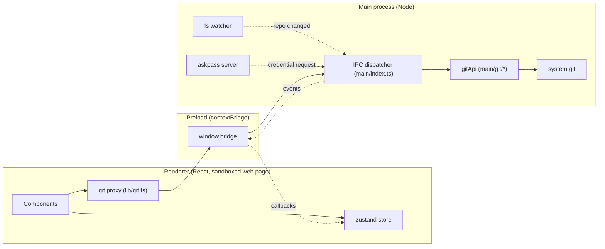
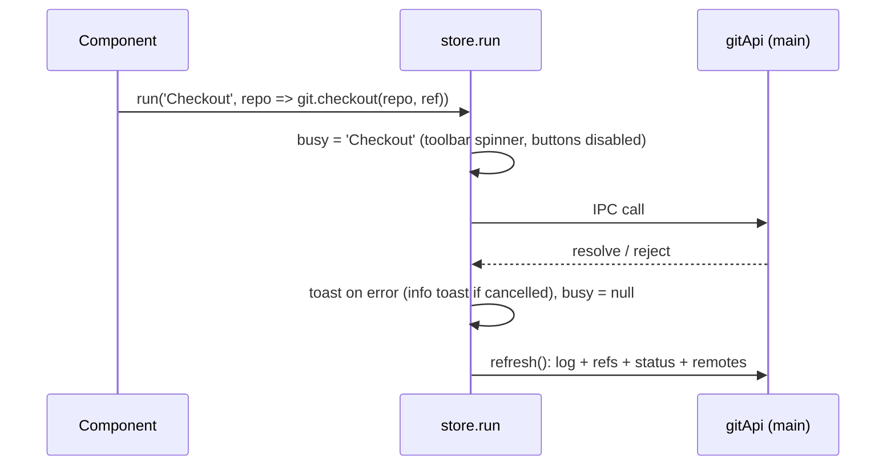

# GitKroken — Technical Manual

For developers who maintain or extend GitKroken. It covers how the app is built, what every module does, the safety rules the code enforces, how it is tested, how to modify it, and what is known to be weak. For how to *use* the app, see the [User Manual](USER_MANUAL.md).

## Contents

1. [Status at a glance](#1-status-at-a-glance)
2. [Requirements and commands](#2-requirements-and-commands)
3. [Architecture](#3-architecture)
4. [Source map](#4-source-map)
5. [The Git backend](#5-the-git-backend)
6. [The `GitApi` contract](#6-the-gitapi-contract)
7. [The renderer](#7-the-renderer)
8. [Feature internals](#8-feature-internals)
9. [Safety model](#9-safety-model)
10. [Tests and verification](#10-tests-and-verification)
11. [How to modify the app](#11-how-to-modify-the-app)
12. [Known risks and limitations](#12-known-risks-and-limitations)
13. [Possible improvements](#13-possible-improvements)
14. [How it was built](#14-how-it-was-built)

---

## 1. Status at a glance

| | |
|---|---|
| What it is | A desktop Git client with a GitKraken-style interface: commit graph, staging, diff viewer, conflict editor, interactive rebase, undo/redo, blame, file history, search, hosting integration. |
| Stack | Electron 39, React 18, TypeScript 5, Vite 5 (through electron-vite), zustand, shiki, lucide-react. No Git library: it runs the system `git`. |
| Size | About 31,000 lines of TypeScript; 29 test files, 604 tests. |
| Language | English only (UI, messages, docs). |
| Platforms | Built and tested on macOS (Apple Silicon, git 2.39, Node 20.11). Windows and Linux code paths exist but are untested. |
| Packaging | None. It runs from source with `npm run dev` or `npm start`. |
| Maturity | New. A data-loss review found 7 high and 8 medium problems; all high ones and most medium ones are fixed and covered by regression tests (section 9). Several features have never run against real services (section 12). |

## 2. Requirements and commands

- Node.js 20.11 or newer, npm 10.
- `git` on the PATH (developed against 2.39).
- Optional: `git-lfs` for the LFS section.

| Command | Purpose |
|---|---|
| `npm install` | Install dependencies and download the Electron binary. |
| `npm run dev` | Run with hot reload (renderer on `http://localhost:5173`). Changes to `src/main` or `src/preload` need a restart. |
| `npm run build` | Bundle main, preload and renderer into `out/`. |
| `npm start` | Run the built app (`electron-vite preview`). |
| `npm test` | Run all tests once (vitest, plain Node, about 30 s). |
| `npm run typecheck` | `tsc --noEmit` over the whole project. |

There is no lint configuration and no installer build.

**Electron version.** The project is pinned to Electron 39.x because the currently supported lines (42 and later) require Node 22.12+ to install. The project originally used 31.7.7, which macOS's malware protection blocked and removed on launch even though the download matched the official checksum; see section 14.

## 3. Architecture

Three processes, as in any Electron app:



**One IPC channel for calls.** The renderer calls `git.someMethod(args)`. `lib/git.ts` is a `Proxy` that turns that into `window.bridge.invoke('someMethod', ...args)`, which the preload forwards on the channel `git:invoke`. The main process looks the method up on the `gitApi` object with `hasOwnProperty` and calls it. Adding a method to `gitApi` therefore makes it callable from the UI with no further plumbing.

**Two event channels main → renderer.** `git:repo-changed` (the file watcher noticed a change; the store refreshes) and `git:credential-request` (git needs a user name, password or passphrase; the renderer shows a dialog and answers with `git.answerCredential`).

**Security settings.** `contextIsolation: true`, `nodeIntegration: false`, `sandbox: false`. The renderer's Content-Security-Policy is `default-src 'self'` with inline styles allowed: the page cannot reach the network, so every HTTP request (GitHub, GitLab) is made by the main process. External links open in the system browser and only `http(s)` URLs are accepted.

**The mutation flow.** Every write goes through `store.run(label, fn, successMsg?)`:



`run` ignores a second call while one is running. `busy` is global, not per tab.

## 4. Source map

```
src/
  shared/types.ts            The contract: GitApi, data types, IPC channel names
  preload/index.ts           Exposes window.bridge (invoke + two event subscriptions)
  main/
    index.ts                 Window creation, IPC dispatch, event forwarding
    git/
      index.ts               Assembles gitApi from the modules below
      exec.ts                Runs git: environment, validation, errors, cancellation
      parse.ts               Parsers for log, refs, status, name-status, remotes
      core.ts                Repositories, reading, staging, commits, branches, remotes, stashes
      net.ts                 Network operations: askpass, cancel, timeouts, clone cleanup
      conflicts.ts           Conflict stages, labels, resolution
      rebase.ts              Interactive rebase and undo/redo
      history.ts             Blame, file history, file-at-revision, commit search
      extras.ts              Submodules, worktrees, LFS
      hosting.ts             GitHub/GitLab accounts, PRs, issues, profiles
      native.ts              The only Electron-dependent bits: dialogs, Finder, terminal
      watcher.ts             File watching and debounce
      __tests__/             Backend tests against real temporary repositories
  renderer/
    index.html               CSP and root element
    src/
      main.tsx, App.tsx      Entry and layout (tab bar, toolbar, three columns)
      store.ts               Global state and actions
      theme.css              Design tokens (colours, sizes) and shared classes
      lib/git.ts             Typed IPC proxy
      lib/refs.ts            Full ref names, rebase confirmation
      components/
        ui/overlays.tsx      Context menu, dialogs, toasts
        tabs/                Tab bar, welcome screen
        toolbar/             Toolbar, repo/branch selectors, shared actions
        sidebar/             Left panel: sections, tree, menus
        graph/               Commit graph: layout, geometry, rows, menus
        details/             Right panel: commit details, staging, commit form
        diff/                Diff viewer: parser, rows, word diff, highlighting, patches
        conflict/            Conflict editor
        rebase/              Interactive rebase view
        history/             Blame, file history, graph search
        extras/              Submodule / worktree / LFS sidebar sections
        hosting/             PR / issue sections, Profiles & Accounts dialog
        net/                 Credential prompt
docs/                        The two manuals and their images
```

CSS class prefixes are per component so files never collide: `g-` graph, `sb-` sidebar, `tool-` toolbar, `tb-`/`wl-` tabs and welcome, `rp-`/`fl-`/`cf-`/`gd-`/`fs-` right panel, `dv-` diff, `ce-` conflict editor, `ir-` interactive rebase, `hv-` history, `ex-` extras, `ho-` hosting.

## 5. The Git backend

### 5.1 Running git (`exec.ts`)

- **No shell.** Git is started with `spawn` and an argument array. User-supplied values are never interpolated into a command string.
- **Validation.** `assertRef` rejects empty values, values starting with `-` and control characters. `assertPaths` rejects empty paths and NUL. Paths are always passed after `--`, with `GIT_LITERAL_PATHSPECS` so `*.txt` means a file with that literal name; long lists go through `--pathspec-from-file` on stdin.
- **Environment.** `LC_ALL=C` for parseable output, `GIT_TERMINAL_PROMPT=0`, `GIT_EDITOR=true` so nothing can open an editor, `GIT_OPTIONAL_LOCKS=0`. Inherited `GIT_DIR`, `GIT_WORK_TREE`, `GIT_INDEX_FILE` and the other location variables are **deleted**, so the app can never be pointed at another repository by its environment. When a profile is active, `GIT_AUTHOR_*` and `GIT_COMMITTER_*` carry its identity.
- **Base config.** Passed with `-c` on every call; includes `diff.autoRefreshIndex=false` so read-only diffs do not rewrite `.git/index`.
- **Errors.** A failed command throws `GitError` whose message is git's stderr without `hint:` lines and `fatal:` prefixes, with `CONFLICT` lines pulled in from stdout.
- **Cancellation.** `RunOptions.signal` kills the whole process group (SIGTERM, then SIGKILL).
- **Output is decoded as UTF-8.** This is lossy for other encodings; see H2 in section 9.

### 5.2 The write queue (`core.ts`)

`withLock(repo, fn)` runs functions for the same repository one after another; `mut(fn)` wraps an API method in it. Before each queued write, `assertRepoRoot(repo)` checks that `repo` is still the top level of a repository. Reads are not queued. `fetch` and `push` are not queued either, so a slow network never blocks staging.

`conflicts.ts`, `rebase.ts` and `extras.ts` each have **their own** queue (the core one was private when they were written; it is exported now). Their writes are serialised among themselves, and against core writes only by git's own `index.lock`. The UI's global `busy` flag hides this in practice.

### 5.3 Modules

**`core.ts`**
- `log`: `git log --date-order` over all refs (excluding `refs/original/*`) plus stash commits, in a NUL-delimited format. Each stash is shown as one node; its helper commits are hidden.
- `refs`: local branches with upstream and ahead/behind, remote branches (without `*/HEAD`), tags (peeled), stashes.
- `status`: `git status --porcelain=v2 -z --branch`, plus detection of an in-progress merge / rebase / cherry-pick / revert from the git directory.
- `diff`: commit, staged, unstaged and untracked variants; `fullContext: true` adds `--unified=10000000` so the diff carries the whole file.
- `discard`, `discardAll`, `checkout`, `createBranch`, `merge`, `rebase`, `reset`, stash operations: see the guards in section 9.
- `push`: destination resolved like git does (`%(push:remotename)`, `%(push:remoteref)`), honouring `remote.pushDefault` and `branch.<n>.pushRemote`. Refused when the destination branch name differs from the local one. Force push is always `--force-with-lease=<ref>:<expected sha>`.
- `pull`: a cancellable `git fetch` followed by a local `git pull . <tracking ref>`, so cancel and timeouts can never interrupt a merge mid-write. Honours `pull.rebase` and `branch.<n>.rebase` unless told otherwise.

**`net.ts`** — section 8.6.

**`conflicts.ts`** — `conflictFile` returns the three index stages, the worktree text, a binary flag and human labels for each side that are correct per operation (in a rebase "ours" is the branch being rebased onto). Non-UTF-8 files are reported as binary. `resolveConflict` writes the content, preserving line endings and the executable bit, and stages it. `resolveWith` takes one side, using `git rm` when that side deleted the file.

**`rebase.ts`** — section 8.4 and 8.5.

**`history.ts`** — `blame` parses `--porcelain`; without `rev` it blames the working tree, so uncommitted lines come back with the all-zero hash. No `-w`, `-M` or `-C`. `fileHistory` uses `--follow` and pages in JavaScript because `--follow --skip` is unreliable across renames. `searchCommits` merges separate message and author searches (literal, case-insensitive) plus a SHA-prefix lookup, under a UTF-8 locale so accented text folds correctly.

**`extras.ts`** — submodules (`status --recursive` + `.gitmodules`), worktrees (`list --porcelain`), LFS. `lfsInstall` is always `--local`. Worktree removal refuses the main worktree, the open one and locked ones.

**`hosting.ts`** — section 8.7.

**`watcher.ts`** — recursive `fs.watch` on the repository, debounced about 300 ms, ignoring `node_modules`, nested `.git` folders, lock files and object writes. Never throws to the caller.

## 6. The `GitApi` contract

Defined in `src/shared/types.ts`; the doc comments there are authoritative. Grouped summary:

| Group | Methods |
|---|---|
| Repositories | `pickDirectory`, `resolveRepo`, `init`, `clone`, `watch`, `unwatch` |
| Reading | `log`, `refs`, `status`, `commitDetails`, `diff`, `remotes` |
| Staging and commits | `stage`, `unstage`, `stageAll`, `unstageAll`, `discard`, `discardAll`, `applyPatch`, `commit` |
| Branches and history | `checkout`, `createBranch`, `deleteBranch`, `renameBranch`, `merge`, `rebase`, `cherryPick`, `revert`, `reset`, `abort`, `continueOp`, `createTag`, `deleteTag` |
| Remotes | `fetch`, `pull`, `push`, `deleteRemoteBranch`, `addRemote`, `removeRemote` |
| Stashes | `stashSave`, `stashPop`, `stashApply`, `stashDrop` |
| Network control | `cancel`, `answerCredential` |
| Conflicts | `conflictFile`, `resolveConflict`, `resolveWith` |
| Rebase and undo | `rebaseTodo`, `rebaseInteractive`, `undoState`, `undo`, `redo` |
| History | `blame`, `fileHistory`, `fileAt`, `searchCommits` |
| Extras | `submodules`, `submoduleUpdate`, `submoduleAdd`, `worktrees`, `worktreeAdd`, `worktreeRemove`, `lfsInfo`, `lfsInstall`, `lfsTrack`, `lfsUntrack`, `lfsPull` |
| Hosting and profiles | `accounts`, `addAccount`, `removeAccount`, `hostedRepo`, `pullRequests`, `createPullRequest`, `issues`, `createIssue`, `profiles`, `saveProfile`, `deleteProfile`, `activateProfile` |
| Misc | `reveal`, `openInTerminal`, `openExternal` |

Conventions that matter when calling it:

- **Refs.** `checkout`, `merge`, `rebase` and `createBranch`'s start point accept full names (`refs/heads/x`, `refs/remotes/origin/x`, `refs/tags/x`). A short name that is both a branch and a tag is rejected as ambiguous. The UI always sends full names (`fullRefName` in `lib/refs.ts`, `fullName` in `graph/actions.ts`).
- **Stashes.** `stashPop/Apply/Drop(repo, index, hash)`: pass the stash commit hash; the call is refused if `stash@{index}` is no longer that commit.
- **Force push.** Pass `lease` (the remote-tracking sha shown to the user).

`src/main/git/__tests__/api.test.ts` asserts that `gitApi` exposes exactly the methods of the contract.

## 7. The renderer

### 7.1 Store (`store.ts`)

| State | Meaning |
|---|---|
| `tabs`, `recent`, `activeRepo` | Open repositories; persisted in `localStorage`. |
| `commits`, `hasMore`, `refs`, `remotes`, `status` | Data of the active repository. |
| `selected` | A commit hash, `WIP`, or null. |
| `selectedFile` | When set, the centre shows the diff viewer. |
| `view` | Centre view: `graph`, `conflict`, `rebase`, `blame`, `fileHistory`. |
| `loading`, `busy` | Refresh in progress; label of the running mutation. |

Actions: `openRepo`, `closeTab`, `setActive`, `refresh`, `loadMore`, `select`, `selectFile`, `openView`, `run`.

- `setActive` first calls `resolveRepo` and closes the tab if the folder is no longer a repository root.
- `refresh` reads log, refs, status and remotes in parallel and discards stale results with a sequence number. Pages are 2,000 commits.
- Refreshes are triggered after every `run`, by the watcher event, and on window focus.

### 7.2 Overlays (`components/ui/overlays.tsx`)

Imperative helpers used everywhere: `showContextMenu(event, items)`, `formDialog` (fields may be `type: 'password'`), `promptDialog`, `confirmDialog`, `toast`. Dialogs trap keyboard focus; when `danger` is set the focus starts on **Cancel**. There is a single dialog slot: opening a second one replaces the first.

### 7.3 Layout (`App.tsx`)

Tab bar; toolbar; then three columns with draggable separators: sidebar, centre, right panel. The centre renders, in order of precedence, the conflict editor, the interactive rebase view, blame, file history, the diff viewer, or the graph.

### 7.4 Persisted keys

All in `localStorage`, prefixed `gitkroken.`: `tabs`, `active`, `recent`, `leftW`, `rightW`, `graph.cols`, `sidebar.collapsed`, `extras.open`, `hosting.collapsed`, `diffMode`, `fileView`, `historyDiffMode`, `historyListW`, `conflictSplit`, `cloneDir`.

In the Electron user-data folder: `hosting-accounts.json` (encrypted tokens) and `profiles.json`. Inside each repository's git directory: `gitkroken/undo.json` and temporary `gitkroken/rebase/` message files.

## 8. Feature internals

### 8.1 Commit graph (`components/graph`)

`layout.ts` is a pure function from the commit list to rows. It walks commits newest-first keeping an array of lanes, each waiting for a hash. A commit takes the leftmost lane waiting for it (or a free one if it is a tip); other lanes waiting for it end there as "joins". Its first parent continues in the same column; further parents become "forks" into existing or new lanes. Columns never shift, so lanes are straight. A parent that is not loaded keeps its lane open to the last row. Colour is `column % 10`.

`geometry.ts` turns a row into SVG path data (one path per colour). `GraphRow.tsx` draws the row: a tinted band from the node to the message column, the node (initials in a ring, a dot for merges, a dashed square for stashes, a dashed circle for WIP) and ref pills. `refLabels.ts` groups refs into pills (a local branch and its in-sync remote share one). `Graph.tsx` virtualises rows and handles columns, keyboard and paging. `actions.ts` holds every context menu.

### 8.2 Diff viewer (`components/diff`)

- `parseDiff.ts`: unified diff → files, hunks, lines with old/new numbers; handles renames, binary files, mode changes, combined diffs, "no newline at end of file".
- `rows.ts`: builds the flat row list for each mode and the geometry for virtualisation.
- `wordDiff.ts`: token-level LCS between a removed line and the added line that replaces it.
- `highlight.ts`: shiki with the Dark+ theme and the JavaScript regex engine (no WebAssembly, so the CSP stays strict). Each side of a hunk is tokenised as one block; tokens are merged with word-diff segments. Skipped above 20,000 lines or 2,000 characters per line.
- `patch.ts`: `buildHunkPatch(file, hunkIndex, { reverse })` produces a one-hunk patch applied with `git apply --recount` (`--cached` to stage, `--cached --reverse` to unstage, `--reverse` to discard).
- **Modes.** Hunk requests the normal 3-line context and offers hunk actions. Inline and Split request `fullContext` and open scrolled to the first change; they offer no hunk actions.

### 8.3 Conflict editor (`components/conflict`)

`regions.ts` computes conflict regions with its own three-way merge of base/ours/theirs, a port of git's xdiff merge that matches `git merge-file` on randomised cases. If the file on disk was merged differently (a custom merge driver), regions are read from the on-disk markers instead and a banner says so. `resolution.ts` models the output as a sequence of blocks; ticking a checkbox regenerates only that conflict's block, and a hand-edited block is never overwritten without confirmation. Unsaved work is kept per file while the user visits other views.

### 8.4 Interactive rebase (`rebase.ts`, `components/rebase`)

- The plan is validated completely before anything is touched: every commit of `base..HEAD` exactly once, no merges in the range, clean tree, attached HEAD, valid first action, non-empty messages.
- The tip is saved as `refs/original/gitkroken/<branch>/<UTC timestamp>` (newest 20 kept). `log` excludes `refs/original/*`, so backups do not appear in the graph.
- `GIT_SEQUENCE_EDITOR` is a constant script that copies a prepared todo file over git's. Messages live in files under `<gitdir>/gitkroken/rebase/` and are applied with `exec git commit --amend -F <file>` lines, so no message is ever placed in a shell string. Squash is written as fixups plus one amend.
- A conflict leaves the rebase in progress for the normal Continue / Abort flow. Any other stop is auto-aborted and the branch verified identical.

### 8.5 Undo / Redo (`rebase.ts`)

The timeline is HEAD's reflog; a journal at `<gitdir>/gitkroken/undo.json` holds the redo stack and is trusted only while the reflog matches what it recorded. Undoable: commit, amend, checkout, reset, merge, pull, cherry-pick, revert, rebase, rename of the current branch. Rules: `reset --hard` is never used (soft, mixed or `--keep`); refuses when files would be overwritten, when an operation is in progress, and when the commits are already on a remote-tracking branch. Not undoable: branch create/delete, stash operations, discards.

### 8.6 Network (`net.ts`)

- **Askpass.** On the first network operation the main process creates a 0700 temporary directory with a small helper and a unix socket. Git and ssh are pointed at the helper (`GIT_ASKPASS`, `SSH_ASKPASS`, `SSH_ASKPASS_REQUIRE=force`); the helper is run by the Electron binary itself with `ELECTRON_RUN_AS_NODE=1`, so it works in dev and in a build. Each operation gets a fresh random token, compared in constant time. The prompt is classified (user name, password, passphrase, host-key confirmation) and sent to the renderer.
- **Secrets** are kept in memory only: never logged, written to disk, put in argv or copied into error messages. Persistence is left to the user's `credential.helper`.
- **Stored hosting tokens** are used silently, but only for HTTPS prompts for the matching host and port.
- **Cancel** (`cancel(repo)`) kills the process group; the call rejects with "Operation cancelled", which `store.run` shows as an info toast. For `clone` the key is the parent directory, and a failed or cancelled clone removes only what it created.
- **Stall protection.** `http.lowSpeedLimit`/`lowSpeedTime` (120 s) and an SSH connect timeout (30 s) unless the user configured their own, plus a 5-minute no-output watchdog that is suspended while a credential dialog is open.

### 8.7 Hosting and profiles (`hosting.ts`, `components/hosting`)

- Tokens are validated against the provider (`/user`), encrypted with Electron `safeStorage` and written with mode 0600. If encryption is unavailable the account is refused; there is no plain-text fallback. Tokens never reach the renderer and are scrubbed from error text.
- `hostedRepo` parses the `origin` URL (https, scp-style ssh, `ssh://`, ports, GitLab subgroups) and matches it to a stored account or a well-known host.
- Lists hold the 50 most recently updated open items and are fetched on repository change and manual refresh only.
- Profiles are a JSON file; `activeIdentity()` feeds the git environment. The user's git config is never modified.

## 9. Safety model

The owner's requirement is that the app must not break branches or lose work without an explicit, accurate confirmation. An independent adversarial review produced the findings below; the "Guard" column is what the code does now. Regression tests are in `src/main/git/__tests__/safety.test.ts`, `push.test.ts` and `env.test.ts`.

| # | Finding | Guard |
|---|---|---|
| H1 | Push went to a differently named upstream branch | Destination resolved like git; refused when names differ. |
| H2 | Hunk patches corrupted non-UTF-8 files | `applyPatch` rejects any patch containing U+FFFD. Whole-file staging is unaffected. |
| H3 | Discard Hunk could hit another hunk after a refresh | The patch is built before the confirmation dialog opens. |
| H4 | Stash drop/pop by index could hit another stash | Hash check inside the queue; the drop toast shows the recovery command. |
| H5 | Short names resolved to the wrong ref | Full ref names from the UI; ambiguous short names rejected; a tag may not be named like a branch, nor the reverse. |
| H6 | A stale tab could act on a parent repository | `assertRepoRoot` before every queued write; tabs re-validated on activation; inherited `GIT_DIR` and friends removed. |
| H7 | Discarding a file deleted untracked files of a folder that replaced it | Refused when a directory stands where the file was. |
| M1 | Discard all silently ended a merge or rebase | `discardAll` refused while an operation is in progress. |
| M2 | Discard all in a repo without commits deletes everything | Dialog states the number of untracked files and the no-commits case. |
| M3 | Stash / checkout / new branch dropped a resolved merge | Refused while an operation is in progress (also `reset`). |
| M4 | Commits on a detached HEAD orphaned by checkout | Checkout refused until a branch holds them. |
| M5 | Reset soft/mixed had no confirmation | All modes confirm; the hard dialog lists every loss. |
| M6 | Rebase had no confirmation | Confirms, and warns about pushed commits. |
| M7 | Checkout of `origin/x` used a stale local `x` | Fast-forwards a local branch that is behind; refused when diverged. |
| M8 | Discarding a staged new file deleted it without saying so | Dialog says the file will be deleted. |
| — | Stage all during a conflict marked files with markers as resolved | `stageAll` refused while files are unmerged. |
| S1 | Amend tick survived a HEAD change | The tick is tied to the HEAD hash and cleared when it moves. |
| S2 | Enter confirmed dangerous dialogs | Focus starts on Cancel. |
| S3 | Focus could leave an open dialog | Focus trap. |
| S5 | Bare `--force-with-lease` | Explicit expected sha. |

**Still open from that review** (low severity, not fixed):

- Staging an untracked nested repository commits it as a gitlink; git's warning is not surfaced.
- With `submodule.recurse=true`, discard all also reverts changes inside submodules.
- `branch -d` on a detached HEAD can delete the last branch pointing at the current commit.
- Unstaging loses index content that differs from the worktree (inherent to git; no confirmation).
- Stash pop/apply run without `--index`, so the staged/unstaged split is not restored.
- Staging one hunk of a file with a mode change also stages the mode.

**Risk per operation** (what the code can destroy):

| Operation | Can destroy | Confirmation | Recoverable |
|---|---|---|---|
| `discard`, discard hunk | Uncommitted content; untracked files | Yes | No |
| `discardAll` | All uncommitted content and untracked files | Yes, with counts | No |
| `reset` hard | Uncommitted content; branch position | Yes | Position via Undo / reflog; content no |
| `reset` soft / mixed | Branch position | Yes | Undo / reflog |
| `stashDrop` | The stash | Yes | `git stash apply <sha>` until gc |
| `deleteBranch -D` | Reachability of its commits | Twice | reflog |
| `deleteRemoteBranch` | The branch on the server | Yes | Only if someone still has it |
| `push` with force | Remote commits not in the local branch | Yes, with count | Only if someone still has them |
| `rebase`, `rebaseInteractive` | Commit identities | Yes | Backup ref (interactive), Undo, `ORIG_HEAD` |
| `resolveWith` | The other side's version of a file | Yes | Abort the operation |
| `worktreeRemove` forced | The folder and its uncommitted work | Twice | No |
| `commit --amend` | The previous commit's identity | No | Undo / reflog |
| `unstage` | Staged-only content | No | `git fsck --lost-found` |

## 10. Tests and verification

### 10.1 Automated tests

`npm test`: 29 files, 604 tests, all passing at the time of writing. Tests run in plain Node; nothing launches Electron or touches the network.

| Area | Files | What they do |
|---|---|---|
| Backend core | `core.test.ts`, `safety.test.ts`, `push.test.ts`, `env.test.ts`, `exec.test.ts`, `watcher.test.ts`, `api.test.ts` | Build real repositories in the temp directory, including a bare repository as remote, and exercise every operation end to end. |
| Network | `net.test.ts` | Askpass through `git credential fill` and real `ssh-keygen`; cancel of deliberately hanging transports; watchdog; clone cleanup. |
| Conflicts | `conflicts.test.ts`, `conflict/*.test.ts` | Real merge, rebase and cherry-pick conflicts; the region algorithm compared with `git merge-file` on random inputs. |
| Rebase and undo | `rebase.test.ts`, `rebase/plan.test.ts` | Every action and combination; hostile messages and config; conflict then continue/abort; every undo/redo case and refusal. |
| History | `history.test.ts` (backend and renderer) | Blame, follow across renames, search semantics. |
| Extras | `extras.test.ts` | Submodules and worktrees for real; LFS against a fake `git-lfs` script. |
| Hosting | `hosting.test.ts`, `hosting/util.test.ts` | Mocked `fetch` and `safeStorage`; URL parsing; error translation. |
| Graph | `layout.test.ts`, `refLabels.test.ts` | Lane continuity on random histories. |
| Diff | `parseDiff`, `patch`, `rows`, `highlight`, `backend.integration` tests | Parser cases; hunk patches round-tripped through real `git apply`. |
| UI | `toolbar.test.tsx`, `details.test.ts`, `net/prompt.test.ts` | Static render and helper logic. |

Test helpers (`__tests__/helpers.ts`) give every test an isolated `HOME` and git config.

### 10.2 Verification in the real app

There is no committed end-to-end suite. During development the built app was driven by a script (run by the Electron binary, using `executeJavaScript` and `capturePage`) against a generated repository with a local bare remote, checking each result with `git`. The last run passed 35 of 35 checks covering: branch creation, checkout, merge, Undo/Redo of a merge and of a commit, a conflicting merge with the guards, the conflict editor through to Continue, stash and pop, single-file discard, the double confirmation for an unmerged branch, reset and rebase confirmations, push, pull, commit, an interactive-rebase reword with its backup ref, file history, blame, search, the new sidebar sections, absence of non-English text, and `git fsck`.

### 10.3 Never verified

- GitHub / GitLab against a real account; real `safeStorage`.
- A real authenticated push or pull through the credential dialog (only anonymous prompts against github.com, cancelled).
- The askpass helper under the packaged app (there is no package).
- Git LFS with the real binary.
- Windows and Linux.
- Real mouse drag and drop (interactive rebase rows, branch pill onto pill).
- Repositories with tens of thousands of commits in the full app (the layout alone handles 30,000 in under 300 ms).

## 11. How to modify the app

### Add a Git operation

1. Declare it in `GitApi` in `src/shared/types.ts`, with a doc comment that states its semantics.
2. Implement it in the right module under `src/main/git/`. Use `git(repo, [...args])`; validate refs with `assertRef` (or `resolveRef` when it names a ref) and paths with `assertPaths`; wrap writes in `mut(...)`.
3. Add it to that module's exported api object, and to the `METHODS` list in `__tests__/api.test.ts`.
4. Write a test in `__tests__/` that builds a temporary repository and checks the result with real git.
5. Call it from the UI through `run('Label', (repo) => git.yourMethod(repo, ...), 'Done message')`.
6. If it can destroy anything, put a `confirmDialog` with `danger: true` before it that says exactly what is lost, and add the operation to the tables in section 9 and in the User Manual.

### Add a context-menu entry

Menus are plain arrays of `{ label, onClick, disabled?, danger? }` or `{ separator: true }`. Graph menus are in `graph/actions.ts`, sidebar menus in `sidebar/menus.ts`, file menus in `details/WipPanel.tsx` and `details/CommitPanel.tsx`. When the action targets a ref, send its full name (`fullRefName(ref)`).

### Add a centre view

1. Add a variant to `CenterView` in `store.ts`.
2. Create the component in its own folder; read its parameters from `useStore((s) => s.view)`.
3. Render it in the chain in `App.tsx`.
4. Open it with `openView({ kind: 'yours', ... })`; close with `openView({ kind: 'graph' })`. Handle Esc.

### Add a sidebar section

Render it from `sidebar/Sidebar.tsx` after the existing ones, using `Section` from `sidebar/Section.tsx` and the `sb-*` classes. Load its data on repository change and after store refreshes, and guard against stale responses.

### Change colours, sizes or fonts

Edit the variables at the top of `src/renderer/src/theme.css` (`--bg-*`, `--text*`, `--accent`, `--lane-0..9`, `--row-h`, `--toolbar-h`). Diff colours are in `diff/DiffView.css`; syntax colours come from the shiki theme named in `diff/highlight.ts`.

### Change wording or add a language

Strings are inline in the components and in backend error messages; there is no translation layer. Changing wording means editing them in place. Supporting a second language requires introducing one (a message catalogue and a lookup function) and replacing every literal; backend errors would need codes instead of English text.

### Upgrade Electron

Install Node 22.12 or newer, then `npm install -D electron@latest` and `npm run build`. Check that `electron-vite` supports the version, and re-run the app once to confirm macOS accepts the binary.

### Package the app

Not set up. Add `electron-builder` or `electron-forge`. Two things to watch: the askpass helper runs the app binary with `ELECTRON_RUN_AS_NODE=1`, which stops working if the `runAsNode` fuse is disabled; and distribution on macOS needs a Developer ID signature and notarisation.

### Rules of the house

- Every write goes through `store.run`; every destructive one is preceded by an accurate confirmation.
- Never build a shell string from user input.
- Keep Electron imports out of the pure-git modules so tests run in plain Node.
- A change to behaviour or risk is not finished until both manuals reflect it.

## 12. Known risks and limitations

**Functional gaps**
- No installer, auto-update, settings screen or translations.
- Pull requests and issues can be listed and created, not reviewed or commented on.
- Interactive rebase cannot handle merge commits in the range or start at the root commit.
- Undo does not cover branch creation/deletion, stash operations or discards.
- Hunk actions exist only in Hunk view, and not for non-UTF-8 files.
- Avatars are initials; no images are loaded.
- LFS patterns in nested `.gitattributes` files are not listed.

**Robustness**
- `store.run` drops an action issued while another is running, and `busy` is shared by all tabs.
- Selecting a ref whose commit is beyond the loaded pages does not load more history (search and "View in graph" do).
- With stashes present, each extra log page re-reads from the top.
- The automatic graph column width is capped at 300 px; wider graphs are clipped until the column is widened.
- A credential dialog can outlive the operation that requested it; answering it then is a no-op.
- There is one dialog slot; the credential prompt works around it by polling.
- Three modules keep their own write queue (section 5.2).
- `sandbox: false` on the window, no `will-navigate` guard, no IPC sender check.

**Code health**
- Helpers duplicated across feature folders (`errText`, `copyText`, `splitRemoteRef`, `stashIndex`, `initials`, a second shiki instance in `history/highlightLines.ts`, a second diff renderer in `history/ReadonlyDiff.tsx`).
- No ESLint configuration; no vitest configuration file (tests rely on `@shared` imports being type-only).
- No committed end-to-end tests.

**Platform**
- Windows: the askpass named pipe, process-tree kill and the `sh`-based rebase helper are written but untested. OpenSSH older than 8.4 ignores `SSH_ASKPASS_REQUIRE`.

## 13. Possible improvements

Ordered roughly by value for effort.

1. Commit the end-to-end script as a real test suite (Playwright for Electron) and run it in CI.
2. Use the exported `withLock` in `conflicts.ts`, `rebase.ts` and `extras.ts` so all writes share one queue.
3. Carry diffs and patches as bytes so hunk staging works for any encoding.
4. Make `busy` per repository and queue actions instead of dropping them.
5. Verify hosting against real GitHub and GitLab accounts, then add PR review, comments and CI status.
6. Packaging, code signing and auto-update; move to a supported Electron line.
7. A settings screen (theme, font size, default diff view, pull behaviour) and a translation layer.
8. Remove the duplicated helpers; add ESLint.
9. A real dialog queue in `overlays.tsx` and an event to withdraw stale credential requests.
10. Record branch create/delete and stash operations so Undo can cover them.
11. Gravatar or provider avatars (requires relaxing `img-src` deliberately).
12. Enable the renderer sandbox and add navigation and IPC sender checks.
13. Lazy loading of history when a ref outside the loaded pages is selected; incremental log paging with stashes.
14. Windows and Linux test passes.

## 14. How it was built

The app was written in one extended session by an orchestrating AI agent that delegated disjoint areas to sub-agents and integrated the results.

1. **Scaffold.** The orchestrator wrote the shared contract (`types.ts`), preload, main entry, store, overlays, theme and stub components, so that parallel work could not collide.
2. **First round, four sub-agents:** Git backend; commit graph; tabs, welcome, toolbar and sidebar; right panel and diff viewer. Each verified its part with tests and a mocked bridge. The orchestrator then drove the real built app against a demo repository.
3. **Electron incident.** The first launch of Electron 31.7.7 was blocked by macOS ("Malware Blocked and Moved to Trash"). The download matched the official SHA-256 and was already ad-hoc signed, so re-signing was not a fix and was not done. The project moved to Electron 39.8.10, which macOS accepts.
4. **Rename and restyle.** Originally "GitAbyss"; renamed GitKroken and restyled after reference screenshots (neutral dark palette, lane-tinted row bands, ring nodes, monospace headers).
5. **Syntax highlighting and whole-file diff views** were added on request.
6. **Safety review.** An independent agent tried to make the backend lose data and reported the findings in section 9.
7. **Second round, six sub-agents:** network and credentials; conflict editor; interactive rebase and undo; blame, history and search; submodules, worktrees and LFS; hosting and profiles. The orchestrator extended the contract first and gave each agent its own files.
8. **Fixes and integration.** The orchestrator applied the safety fixes with regression tests, switched the whole UI from Spanish to English at the owner's request, and ran the 35-check scenario in the real app.

The first-round UI was written in Spanish; if a Spanish string ever surfaces, it is a leftover and should be translated.
