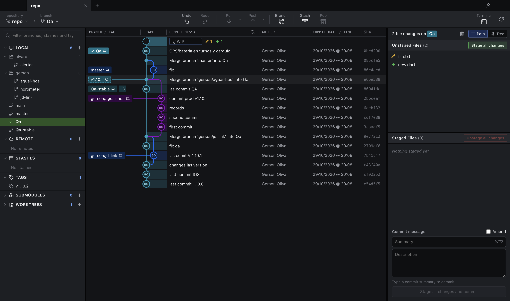
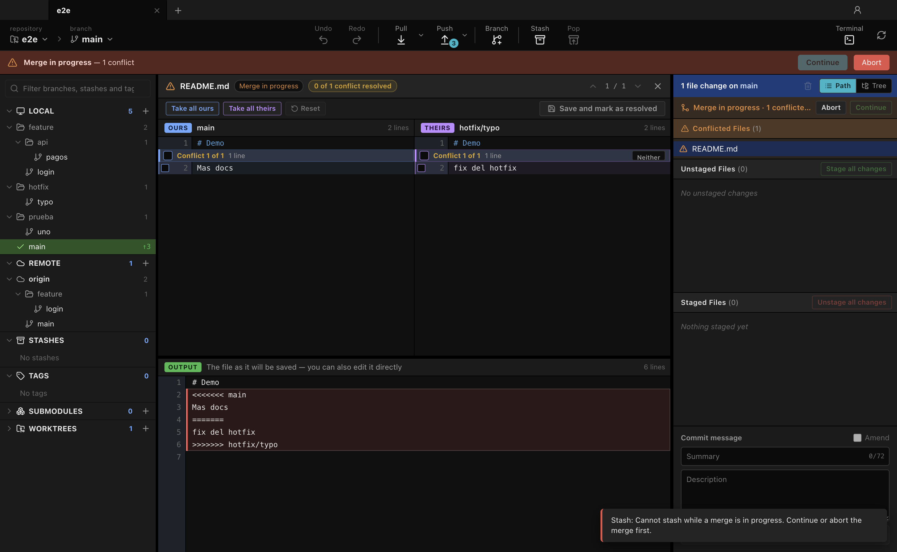
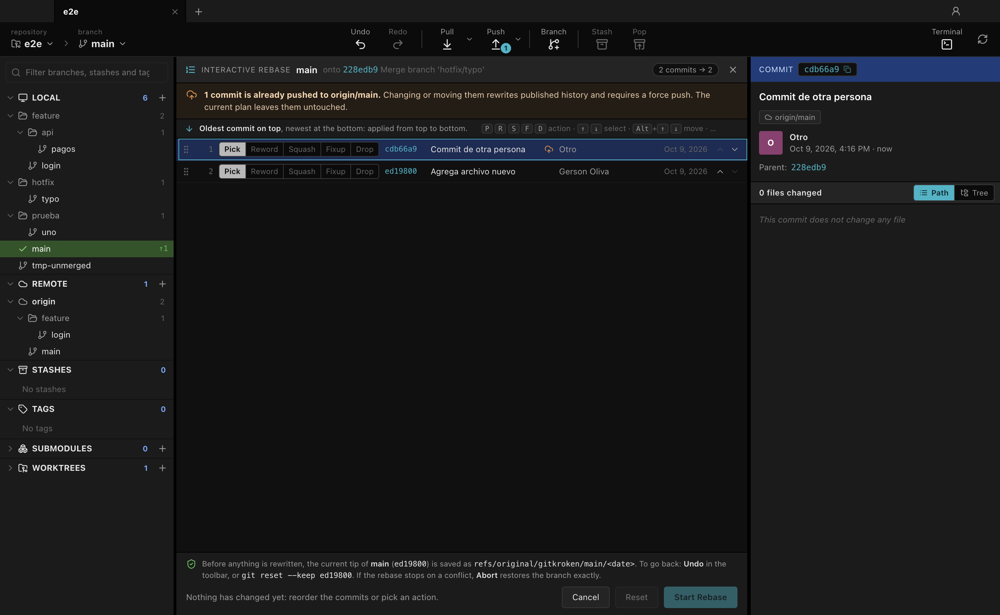
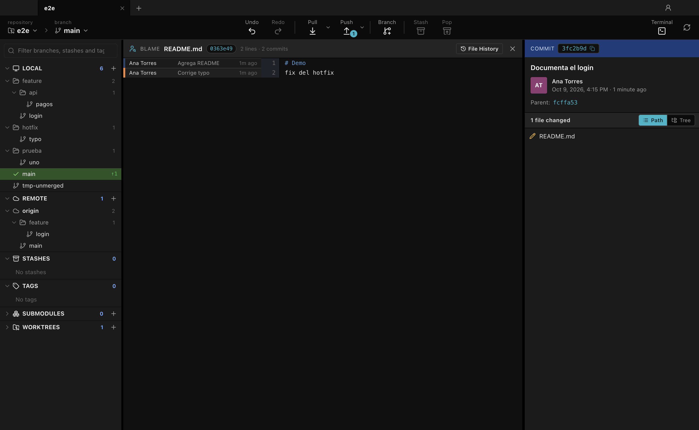

# GitKroken — User Manual

This manual is for people who use GitKroken, not for people who program it. It explains what every part of the window does, how to carry out everyday tasks, which actions can lose work, and what to do when something goes wrong. For how the app is built and how to change it, see the [Technical Manual](TECHNICAL_MANUAL.md).



## Contents

1. [What GitKroken is](#1-what-gitkroken-is)
2. [Starting the app](#2-starting-the-app)
3. [A tour of the window](#3-a-tour-of-the-window)
4. [Everyday tasks](#4-everyday-tasks)
5. [Working with branches](#5-working-with-branches)
6. [Working with a server (push, pull, fetch)](#6-working-with-a-server-push-pull-fetch)
7. [Resolving conflicts](#7-resolving-conflicts)
8. [Undo and Redo](#8-undo-and-redo)
9. [Rewriting history (interactive rebase)](#9-rewriting-history-interactive-rebase)
10. [Looking into the past](#10-looking-into-the-past)
11. [Stashes](#11-stashes)
12. [GitHub and GitLab](#12-github-and-gitlab)
13. [Profiles](#13-profiles)
14. [Submodules, worktrees and Git LFS](#14-submodules-worktrees-and-git-lfs)
15. [Which actions can lose work](#15-which-actions-can-lose-work)
16. [If something goes wrong](#16-if-something-goes-wrong)
17. [What the app cannot do yet](#17-what-the-app-cannot-do-yet)
18. [Changing the app](#18-changing-the-app)
19. [Keyboard shortcuts](#19-keyboard-shortcuts)
20. [Glossary](#20-glossary)

---

## 1. What GitKroken is

GitKroken is a desktop program for working with Git repositories using the mouse instead of typed commands. It shows the history of a project as a coloured graph, lets you prepare and save changes (commits), move between branches, exchange work with a server, and fix conflicts when two people changed the same lines.

It does not replace Git. It runs the Git program already installed on your computer, so anything it does can also be seen, and if necessary repaired, from a terminal.

**Before you rely on it, read this.** GitKroken is new software. It was reviewed for ways of losing work and the problems found were fixed, but several parts have only been tested automatically and not by a person in daily use (they are listed in section 17). Until you trust it, keep your important work pushed to a server, and read section 15 before using an action marked as dangerous.

## 2. Starting the app

There is no installer yet. A developer starts it from the project folder:

```bash
npm install
npm run dev
```

The first command is only needed once. The second opens the window.

When the window opens with no repository, you see the **welcome screen** with three choices:

| Button | What it does |
|---|---|
| **Open a repo** | Choose a folder on your computer that already is a Git repository. |
| **Clone a repo** | Copy a repository from a server. You give its address (URL) and the folder to put it in. A **Cancel clone** button stops it. |
| **Start a local repo** | Turn a folder into a new, empty repository. |

Below them is the list of repositories you opened recently.

## 3. A tour of the window

The window has five areas.

### Tab bar (top)

One tab per open repository. Click a tab to switch, the **×** to close it, and **+** to go back to the welcome screen. On the right, the person icon opens **Profiles & Accounts** (sections 12 and 13).

### Toolbar

| Control | What it does |
|---|---|
| **repository** / **branch** (left) | Switch to another open repository, or to another local branch. Both have a search box. |
| **Undo** / **Redo** | Reverse or repeat your last action (section 8). Hover to see what would be undone. |
| **Pull** | Bring the server's new commits into your branch. The small arrow next to it offers *Fetch All*, *Pull (merge)* and *Pull (rebase)*. |
| **Push** | Send your commits to the server. The small arrow offers *Force Push (with lease)*. A number on the button shows how many commits are waiting. |
| **Branch** | Create a new branch where you are and switch to it. |
| **Stash** / **Pop** | Put your unsaved changes aside, and bring them back (section 11). |
| **Terminal** | Open a terminal in the repository folder. |
| Refresh icon | Reload everything from disk. |

While something that talks to a server is running, a spinner and a **Cancel** button appear.

When a merge, rebase, cherry-pick or revert is waiting for you, a coloured bar appears under the toolbar with **Continue** and **Abort**.

### Left panel

A filter box at the top, then collapsible sections. A number shows how many items each holds.

| Section | Contents |
|---|---|
| **LOCAL** | Your branches. Names with `/` are shown as folders. The current branch is highlighted in green. `↑2 ↓1` means 2 commits to push and 1 to pull. |
| **REMOTE** | Branches on each server. |
| **STASHES** | Changes you put aside. |
| **TAGS** | Named points in history, usually versions. |
| **SUBMODULES**, **WORKTREES**, **LFS** | See section 14. |
| **PULL REQUESTS**, **ISSUES** | Appear when the repository lives on GitHub or GitLab (section 12). |

Click an item to select its commit in the graph. Double-click a branch to switch to it. Right-click for more actions.

### Graph (centre)

Each row is a commit; the newest is at the top. The coloured lines show how branches split and join. The labels on the left show which branch or tag points at each commit. The top row, **// WIP**, appears when you have changes that are not yet committed.

Click a row to see its details on the right. Right-click a row, or a label, for actions. Drag a column edge to resize it.

### Right panel

- With a **commit** selected: its message, author, date and the list of files it changed. Click a file to see what changed.
- With **// WIP** selected (or nothing selected and work pending): the staging area and the commit form (section 4).

## 4. Everyday tasks

### See what changed in a file

Click the file in the right panel. The centre shows the differences: removed lines in red, added lines in green, with code colouring.

Three views are available at the top right:

| View | Shows |
|---|---|
| **Hunk** | Only the changed pieces. For uncommitted files, each piece has **Stage Hunk** / **Discard Hunk** buttons. |
| **Inline** | The whole file, old and new lines together. Opens at the first change. |
| **Split** | The whole file, old version on the left and new on the right. |

Close with the **×** or the Esc key.

### Save your work (commit)

1. Select **// WIP** at the top of the graph.
2. In the right panel, files are listed under **Unstaged Files**. Hover a file and press **Stage** to include it in the commit, or press **Stage all changes**.
3. Type a short **Summary** (and, if you want, a longer description).
4. Press the green commit button, or Cmd+Enter (Ctrl+Enter on Windows and Linux).

To include only part of a file, open it in **Hunk** view and press **Stage Hunk** on the pieces you want.

To correct the last commit instead of making a new one, tick **Amend**. Do not amend a commit you already pushed unless you know you will need a force push.

### Throw away a change

Right-click a file → **Discard changes…** (for a new file the entry is **Delete file…**). The app always asks first. Discarding cannot be undone: the changes are gone. For a brand-new file, discarding deletes the file.

## 5. Working with branches

| I want to… | How |
|---|---|
| Create a branch | **Branch** in the toolbar, or right-click a commit → **Create branch here**. |
| Switch branch | Double-click it in the left panel or on its label in the graph. |
| Bring another branch into mine (merge) | Right-click that branch → **Merge X into Y**. |
| Replay my branch on top of another (rebase) | Right-click that branch → **Rebase Y onto X**. The app asks first, and warns if your commits were already pushed. |
| Copy one commit onto my branch | Right-click the commit → **Cherry pick commit**. |
| Cancel what a commit did | Right-click the commit → **Revert commit** (creates a new commit that does the opposite). |
| Move my branch back to an older commit | Right-click the commit → **Reset … to this commit** (Soft, Mixed or Hard). Read section 15 first. |
| Rename or delete a branch | Right-click it. |
| Mark a version | Right-click a commit → **Create tag here**. |

You can also **drag one branch label onto another** in the graph: a small menu offers to merge or rebase between them.

If you switch branches while you have unsaved changes that the other branch would overwrite, Git refuses and nothing is lost. Commit or stash first.

## 6. Working with a server (push, pull, fetch)

- **Fetch** downloads what is new on the server without touching your files.
- **Pull** fetches and then brings those commits into your current branch.
- **Push** uploads your commits.

**If the server asks who you are**, a dialog appears asking for a user name, a password or access token, or the passphrase of your SSH key. The app does not keep what you type; if your computer is set up to remember Git passwords (the system keychain), Git stores it there as usual.

**If a push is rejected** because the server has commits you do not have, pull first and push again.

**Force push** replaces the server's branch with yours. Use it only after you deliberately rewrote history (amend, rebase). The app shows how many commits on the server would be discarded and asks for confirmation. It refuses if the server changed since you last looked.

**A safety rule you may run into:** the app refuses to push your branch onto a server branch with a *different name*. This prevents, for example, a branch created from `origin/main` from being pushed straight onto `main`. Rename your branch or set its destination from a terminal if that is really what you want.

## 7. Resolving conflicts

A conflict happens when a merge, rebase or cherry-pick meets lines that both sides changed. The operation pauses, the bar under the toolbar says how many conflicts there are, and the files appear under **Conflicted Files**.



Click a conflicted file to open the **conflict editor**:

- Top left is **OURS**, top right is **THEIRS**; each is labelled with what it really is (the branch name, or the commit being applied).
- Tick the boxes of the lines you want to keep. You may tick both sides.
- The **OUTPUT** at the bottom shows the file as it will be saved. You can also type in it directly.
- **Take all ours** / **Take all theirs** choose one side for every conflict.
- **Save and mark as resolved** writes the file. If conflict markers (`<<<<<<<`) are still in it, the app tells you and does not save unless you insist.

When every file is resolved, press **Continue** in the bar. To give up and return everything to how it was before, press **Abort**.

While an operation is paused, the app deliberately refuses to stash, switch branch, reset, discard everything or stage everything, because each of those would silently throw the half-finished operation away.

## 8. Undo and Redo

**Undo** reverses your last action when it was one of these:

| Last action | What Undo does |
|---|---|
| Commit or amend | Goes back to before it. Your changes stay staged, nothing is lost. |
| Switching branch | Switches back. |
| Reset | Puts the branch back where it was. |
| Merge, pull, cherry-pick, revert, rebase | Puts the branch back where it was. |
| Renaming the current branch | Renames it back. |

**Redo** repeats what you just undid. Doing anything new clears Redo.

Undo is careful by design. It refuses, and explains why, when:

- undoing would overwrite changes you have not committed;
- a merge or rebase is still in progress;
- the commit was already pushed to the server.

It cannot undo: discarded changes, deleted or created branches, and stash actions.

## 9. Rewriting history (interactive rebase)

Use this to tidy up commits **before** sharing them: reorder them, change a message, combine several into one, or remove one.



1. Right-click the oldest commit you want to change → **Interactive rebase from here**.
2. The list shows the commits, oldest at the top. For each one choose **Pick** (keep), **Reword** (change the message), **Squash** (combine into the one above, keeping both messages), **Fixup** (combine and drop this message) or **Drop** (remove).
3. Drag rows, or use the arrows, to reorder.
4. Press **Start Rebase**.

Before anything changes, the app saves a copy of your branch. If a conflict appears, resolve it as in section 7 and press Continue, or Abort to get the branch back exactly as it was. Afterwards, **Undo** also restores it.

A banner warns you when some of the commits are already on the server: changing those requires a force push and disturbs anyone who has them.

## 10. Looking into the past

| Tool | How to open it | What it shows |
|---|---|---|
| **Search** | Cmd+F (Ctrl+F), or the magnifier in the graph header | Commits whose message, author or identifier contains your text. Enter jumps to the next match. |
| **File History** | Right-click a file, or the clock icon above a diff | Every commit that changed that file, following renames, with the change each one made. |
| **Blame** | Right-click a file, or the icon above a diff | The file with, beside each line, who last changed it and when. Click a block for the commit; **Blame before this commit** goes further back. |



## 11. Stashes

A stash puts your uncommitted changes aside so you can do something else and come back.

- **Stash** (toolbar) saves all changes, including new files.
- **Pop** (toolbar) brings back the most recent stash and removes it from the list.
- Right-click a stash in the left panel or the graph for **Apply stash** (bring back, keep the stash), **Pop stash** and **Delete stash**.

Deleting a stash loses what was in it. Immediately after deleting, the notice shows a command that can still recover it; copy it if you made a mistake.

## 12. GitHub and GitLab

If your repository is hosted on GitHub or GitLab you can see and create pull requests and issues from the left panel.

1. Click the person icon in the tab bar → **Profiles & Accounts** → **Connect to GitHub** (or GitLab).
2. Create a *personal access token* on the provider's website (the dialog has a button that opens the right page and says which permissions to grant) and paste it.

The token is stored encrypted using your computer's keychain and never shown again. Remove the account in the same dialog to delete it.

Then, in the left panel:

- **PULL REQUESTS** (called **MERGE REQUESTS** on GitLab): click one to select its branch in the graph, double-click to open it in the browser, right-click to check out its branch. **+** creates one from your current branch.
- **ISSUES**: open in the browser, or **+** to create one.

This feature has not been tried against a real account yet (section 17).

## 13. Profiles

A profile is a name and e-mail address to sign your commits with. Create them in **Profiles & Accounts** and choose the active one. While a profile is active, commits made from the app use it. Your own Git configuration is never changed; choose **Use the Git configuration** to go back to it.

## 14. Submodules, worktrees and Git LFS

These are advanced Git features; ignore the sections if you do not use them.

- **SUBMODULES** — another repository kept inside yours. Double-click to open it in its own tab; right-click to download or update it; **+** to add one.
- **WORKTREES** — a second folder with another branch of the same repository checked out. Double-click to open; **+** to create. Removing a worktree that has unsaved changes needs a second confirmation, because that work would be deleted.
- **LFS** — storage for large files. Shows which file types are tracked and lets you add or remove types and download the files. It needs the separate `git-lfs` program; if it is missing the app tells you how to install it.

## 15. Which actions can lose work

Git almost never loses *committed* work: old commits can usually be recovered. What is fragile is **work you have not committed**.

| Action | Risk | What the app does to protect you |
|---|---|---|
| **Discard changes** (a file) | The uncommitted changes are gone for good. New files are deleted. | Always asks. Says so when the file will be deleted. |
| **Discard Hunk** | That piece of the file is gone for good. | Always asks. |
| **Discard all changes** | Every uncommitted change is gone; untracked files are deleted. | Asks, and tells you how many files will be deleted. Disabled during a merge or rebase. |
| **Reset … Hard** | Uncommitted changes gone; the branch drops the later commits. | Asks. The commits can be brought back with Undo; the uncommitted changes cannot. |
| **Reset … Soft / Mixed** | The branch drops the later commits, but their changes stay in your files. | Asks. Undo restores it. |
| **Delete stash** | The stashed changes are lost. | Asks. Shows a recovery command afterwards. |
| **Delete branch** | Commits that exist only on that branch become hard to find. | Asks. If the branch is not merged, asks a second time before forcing. |
| **Delete remote branch** | Removed on the server for everyone. | Asks. |
| **Force push** | Commits on the server that you do not have are removed for everyone. | Asks, shows how many. Refuses if the server changed. |
| **Rebase / interactive rebase** | Commits get new identities; pushed ones will need a force push. | Asks. Saves a backup of the branch first. |
| **Take ours / Take theirs** (conflict) | The other side's version of that file is dropped. | Asks. |
| **Remove worktree** (forced) | The folder and any unsaved work in it are deleted. | Asks twice. |
| **Amend** a pushed commit | Requires a force push afterwards. | No special warning. Avoid it. |
| **Unstage** | Normally harmless. In the rare case where the staged version differs from the file on disk, the staged version is lost. | No confirmation. |

Three habits that keep you safe: commit often, push before doing anything in this table, and read the confirmation dialog instead of pressing Enter. In dangerous dialogs the app puts the keyboard focus on **Cancel**, so Enter cancels.

## 16. If something goes wrong

**I committed too early, or to the wrong branch.** Press **Undo**. The commit is removed and your changes are still there, staged.

**I merged, pulled or rebased and regret it.** Press **Undo** (your working folder must have no uncommitted changes in the way).

**An operation is stuck with conflicts and I want out.** Press **Abort** in the bar under the toolbar. Everything returns to how it was before.

**An interactive rebase went wrong and Undo is not available.** Your branch was saved before the rebase. A developer can restore it from a terminal; the backups are listed with:

```bash
git for-each-ref refs/original/gitkroken/
```

and restored with `git reset --keep <the identifier shown>`.

**I deleted a stash by mistake.** The notice shown right after deleting contains a command such as `git stash apply 1a2b3c4d5e`. Run it in the terminal. If the notice is gone, a developer can still find it with `git fsck --lost-found` for some weeks.

**I lost commits (deleted branch, hard reset).** They are not deleted immediately. In a terminal, `git reflog` lists where your branch has been; `git branch rescue <identifier>` brings a lost commit back as a branch.

**The app says a folder "is no longer the root of a Git repository".** The folder was moved or its hidden `.git` folder was removed. The app closes the tab on purpose instead of acting on the wrong repository. Open the repository again from its new location.

**The app refuses to switch branch because "HEAD is detached and has commits not on any branch".** You made commits while not on a branch. Create a branch (toolbar **Branch**) to keep them, then switch.

**A name "is ambiguous".** A branch and a tag have the same name. Rename one of them.

**The server does not respond.** Press **Cancel**. Network operations also stop by themselves after a period with no response.

**The window shows something that does not match reality.** Press the refresh icon at the right of the toolbar.

**I discarded changes by mistake.** These cannot be recovered by the app or by Git. Check whether your editor keeps a local history of the file.

## 17. What the app cannot do yet

Not available:

- An installer or automatic updates.
- Pull request reviews, comments and approvals (only listing and creating).
- Undo for discards, branch deletion and stash actions.
- Interactive rebase of ranges that contain merge commits, or starting at the very first commit.
- Staging single pieces of files that are not in UTF-8 text encoding (the whole file can still be staged).
- Images of people's avatars (initials are shown instead).
- Any language other than English.

Built but not yet confirmed by real use:

- GitHub and GitLab features against a real account.
- Pushing and pulling with a real password, token or SSH passphrase through the app's dialog.
- Git LFS with the real `git-lfs` program (it was not installed on the machine where the app was built).
- Windows and Linux. The app was built and tested on macOS only.
- Dragging with the mouse: reordering in interactive rebase and dropping one branch on another were tested with simulated events only.

## 18. Changing the app

Nothing in the app's behaviour can be changed from inside the app: there is no settings screen. What it remembers on its own is the size of the panels and columns, the open tabs, which sections are collapsed and which diff view you prefer.

Changes that need a developer but are small:

| Change | Difficulty |
|---|---|
| Colours and font sizes | Easy: one file of colour definitions. |
| Wording of buttons and messages | Easy, but spread over many files. |
| A new item in a right-click menu | Easy. |
| A new Git operation | Moderate. |
| Another language, a settings screen, an installer | Larger projects. |

The [Technical Manual](TECHNICAL_MANUAL.md) has step-by-step instructions for each.

## 19. Keyboard shortcuts

On Windows and Linux use Ctrl where this table says Cmd.

| Where | Keys | Action |
|---|---|---|
| Graph | ↑ ↓, Page Up/Down, Home, End | Move the selection |
| Graph | Cmd+F | Search commits |
| Search | Enter / Shift+Enter, F3 | Next / previous match |
| Search, diff, blame, history | Esc | Close |
| Commit form | Cmd+Enter | Commit |
| Conflict editor | F7 / Shift+F7 | Next / previous conflict |
| Conflict editor | Cmd+S | Save and mark as resolved |
| Interactive rebase | P, R, S, F, D | Pick, Reword, Squash, Fixup, Drop |
| Interactive rebase | ↑ ↓ / Alt+↑ ↓ | Select / move a commit |
| Interactive rebase | Ctrl+Enter | Start Rebase |
| Dialogs | Esc | Cancel |

## 20. Glossary

| Word | Meaning |
|---|---|
| **Repository** | A project folder whose history Git records. |
| **Commit** | A saved snapshot of the project, with a message. |
| **Branch** | A named line of commits. You work on one branch at a time. |
| **HEAD** | Where you are right now. "Detached HEAD" means you are looking at a commit that no branch points to. |
| **Stage** | To mark a change as part of the next commit. |
| **Working directory** | The files as they are on your disk right now. |
| **Remote** | A copy of the repository on a server. `origin` is the usual name. |
| **Push / Pull / Fetch** | Upload / download-and-combine / download only. |
| **Merge** | Combine another branch into yours, keeping both histories. |
| **Rebase** | Re-create your commits on top of another branch, as if you had started from there. |
| **Conflict** | Two changes to the same lines that Git cannot combine by itself. |
| **Stash** | A shelf for uncommitted changes. |
| **Tag** | A permanent name for one commit, typically a version number. |
| **Hunk** | One continuous piece of changed lines in a file. |
| **Force push** | A push that replaces the server's branch instead of adding to it. |
| **Reflog** | Git's private diary of where each branch has been; the basis for most recoveries. |
